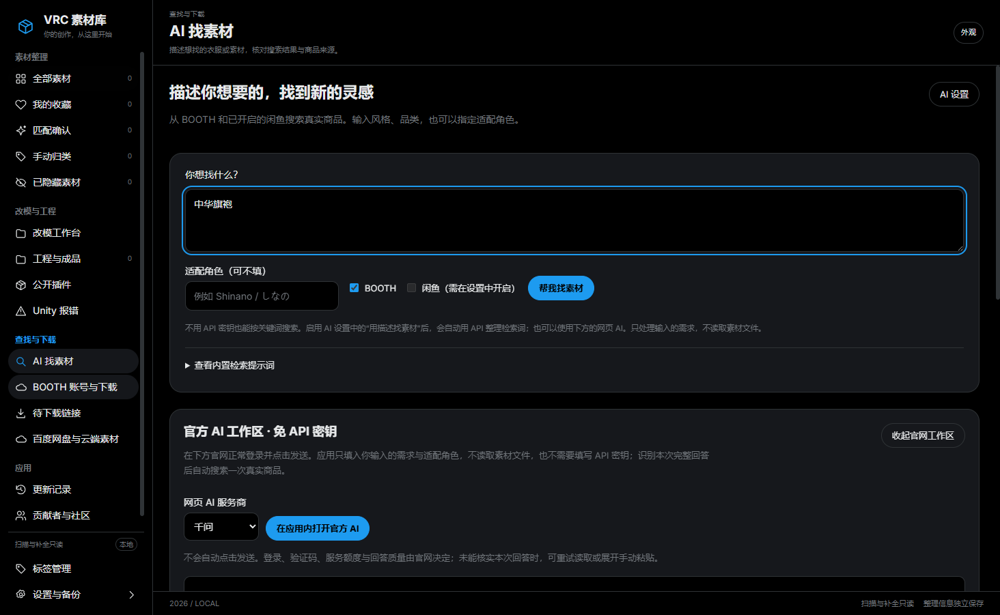
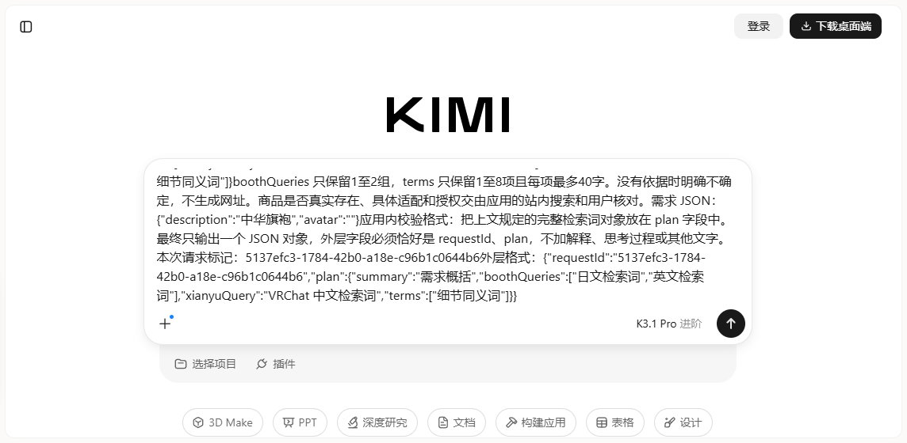
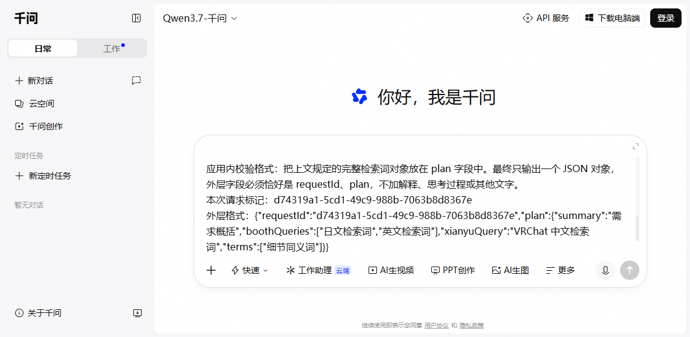

# 用一句话找素材

这个页面用于**寻找你还没有下载的商品**。给本地素材补封面和来源，仍在“匹配确认”中进行。

## 第一次使用

1. 打开应用，在左侧点击 **AI 找素材**。
2. 在“你想找什么？”里输入，例如：**我想要一件黑白配色的哥特蕾丝礼裙**。原来的三条示例按钮已经移除，直接输入自己的需求。
3. 如果想限定角色，在“适配角色”里填写作者常用的名字，例如 `Shinano` 或 `しなの`。不知道可留空。
4. 默认选中 BOOTH。希望同时搜索闲鱼时，先在“设置与备份”启用闲鱼辅助搜索并阅读提醒，再勾选此页的闲鱼。
5. 点击 **帮我找素材**。商品会逐步显示，封面随后加载；搜索过程中可点击“停止搜索”。
6. 查看卡片上的平台、标题、作者（网页有提供时）、命中词和适配提示。点击“检索依据”可以看到这件商品使用了什么搜索词、原始网址和完整标题。
7. 点击 **在内置浏览器查看商品**，核对商品的适配版本、内容、价格和作者授权。

**搜索到商品不代表已经购买、下载或导入。** 应用不会因为搜索结果而修改本地素材、绑定来源或给角色安装东西。需要购买的商品按原作者与平台流程处理；BOOTH 账号与下载、待下载链接仍沿用原有页面。

## 可不配置 AI，先试用

没有密钥也能使用。应用会把常见的“哥特、礼裙、洛丽塔、和服、赛博”等词转换为日文和英文关键词，并标为 **本地关键词检索**。它只是有限的词语规则，不会理解所有描述或保证颜色、价格等条件。

应用已内置 VRChat 检索提示词，会要求 AI 分清品类、风格、颜色和细节，整理简短的 BOOTH 日文／英文词及闲鱼中文词。页面可展开“查看内置检索提示词”。API 和网页方式使用同一套提示词。

开启 AI 后，由 AI 整理复杂描述和检索词。商品本身仍来自网站真实搜索结果，AI 不提供商品网址，不凭空生成封面或商品。

## 不填 API 密钥，在应用内使用网页 AI

这条方式使用自己的千问、Kimi 或 DeepSeek 官方网页账号，不调用应用配置的 API，也不计入应用的 API 调用次数。官网的登录、验证和额度规则照常适用。

1. 开启应用联网，在左侧进入 **AI 找素材**。
2. 在 **你想找什么？** 输入需求，例如“黑白配色的哥特蕾丝礼裙”。适配角色可以留空；勾选 BOOTH，或在已启用闲鱼辅助搜索时一并勾选闲鱼。
3. 在 **官方 AI 工作区 · 免 API 密钥** 选择服务商，点击 **在应用内打开官方 AI**。官网出现在本页的网页区域，不会跳到系统浏览器。
4. 若官网要求登录，请在这块官网区域正常操作。密码和验证码只在官网输入，无需发给维护者。
5. 应用尝试填入本次检索需求。**不会自动点击发送，也不会覆盖已有草稿。** 请检查输入框内容，再在官网点击发送。如果没有填好，先确认已登录、输入框可用且没有草稿，再点 **重试填入需求**。也可以点 **复制本次提示词**，在同一官网的输入框按 Ctrl＋V。
6. 等待官网回答。应用只尝试读取最后一个受支持的回答区；本次独立标记、完整结构和检索词都校验通过，并在连续读取中稳定后，自动搜索一次真实商品。
7. 往下看商品卡片，点击 **在内置浏览器查看商品** 核对真实来源和适配。AI 整理的词不构成适配或授权证明。

官网首次加载可能较慢，请等待页面准备好。若官网提示使用环境异常或要求验证，请按官网正常流程处理，或切换服务商；应用不绕过这些限制。首次登录后，官网可能重新载入页面；请检查提示词仍在正确的输入框中。应用不自动发送账号消息，不扫描完整历史对话，不通过网站未公开接口调用 AI。切页或关闭工作区会取消本次网页任务；修改需求、角色、平台或服务商后，需要重新打开本次需求。打开应用设置、外观菜单或手动回答区时，官网会暂时隐藏，避免遮挡操作。

### 实机画面

以下为隔离资料库的实际界面，未登录真实账号、未发送消息。分别截取应用页面和内嵌官网区域，便于看清按钮。

### 没有自动得到结果怎么办

- 官网还在输出：先等回答完成，再点 **重新读取本次回答**。
- 提示词没有出现：检查登录和草稿，使用 **重试填入需求**；已有草稿请自己处理，程序不会替你删除。
- 官网结构变化或 AI 附加了大量解释：展开 **手动粘贴完整 JSON（备用）**，复制官网本次完整 JSON（可含一对 json 代码围栏）粘贴后，点击 **使用粘贴回答搜索商品**。可以直接粘贴本次包含 requestId 和 plan 的完整回答，也兼容旧版只有检索词的 JSON。手工粘贴是你主动选择使用该回答，请核对需求是否对应。
- 官网不可用但应用仍联网时：查看本页具体提示，原有商品结果保留；可用上方 **帮我找素材** 按本地关键词规则搜索网站（开启 API 用途时使用所配 API）。应用关闭联网时，需要先恢复联网才能查询商品。

### 登录保存在哪里

三家官网各用独立会话，保存在所选资料库的 `ai-web-qwen`、`ai-web-kimi`、`ai-web-deepseek`，必要的加密 Cookie 快照使用同名 `-cookies.bin` 文件。通过应用更改资料库位置会一并迁移；普通资料库备份不含这些凭证。点击 **退出该官网并清除会话** 可清除本机该官网的登录、网页存储和快照；不会删除其他平台登录或官网服务器上的对话。旧资料库副本和系统备份不会随此操作擦除。

本次提示词、独立标记和用于解析的回答只在当前任务内存中使用，不写入 API 派生缓存。官网自身仍可能保留对话及浏览器缓存；详情见[隐私说明](PRIVACY.zh-CN.md)。应用自动填入的是内置提示词、脱敏需求、角色线索和本次随机标记；官网正常登录和访问还按其政策处理 Cookie 等信息。应用不会把本地模型、图片、工程或聊天收件箱交给 AI。

### 本版验证边界

隔离实机验收使用拦截的合成官网验证填写、回答识别和搜索衔接；不等于已经验收三家真实账号、验证码、地区限制或回答质量。官网变化时自动识别可能失效，同页手工入口继续可用。本功能只用于找素材，不同时覆盖免密钥分类和报错解释。

## 配置千问、Kimi 或 DeepSeek

1. 点击页面右上方 **AI 设置**。
2. 选择服务商。点击密钥申请页，在服务商自己的平台申请 API 密钥。聊天会员不一定含 API 额度。
3. 将密钥填入“API 密钥”；保留默认模型，或填写服务商当前允许使用的模型名称。
4. 勾选“启用 AI 辅助”和 **用描述找素材**，阅读发送范围和可能产生的费用，再勾选同意并保存。
5. 回到需求框重新搜索。正常使用 AI 时显示 **AI 辅助检索**；密钥、额度或网络有问题时显示具体提示，并改用本地规则。

每天默认最多 20 次，找素材、分类、报错解释共用额度。相同需求的有效 AI 结果使用缓存；限额是调用次数，不是费用上限。

## 闲鱼登录与验证

应用使用自己保存的闲鱼会话，在后台打开正常的官方搜索网页读取商品卡片。不会读取聊天，不会调用私有搜索接口，也不会自动下单。

第一次尚未登录或网站要求验证码时，点击结果区域的 **打开站内搜索**，在官方页面正常完成登录／验证，回到应用再搜索。不会要求提供账号密码给 AI。网页改版或没有返回可识别卡片时，会提示未能读取，保留 BOOTH 的结果。

## 如何看懂结果

- **BOOTH / 闲鱼**：这件商品来自哪个平台。闲鱼卖家声明不是 BOOTH 原作者确认。
- **标题命中**：标题里实际出现的词，不是 AI 评分或购买建议。
- **标题提及某角色**：只说明标题包含角色名；仍需核对具体文件和版本。
- **未确认支持某角色**：当前证据不足，不表示一定不支持，也不表示支持。
- **封面暂不可用**：保留商品和原网址，可在内置浏览器核对。
- 每个平台最多展示 12 件，BOOTH 最多两组关键词；可以调整描述继续找。

手动搜索与自动补全的暂停分开，但仍共享网站请求间隔、限流和缓存。关闭联网会停止本次搜索。切换应用页面后当前结果仍在；退出应用后结果列表不作为购买清单保存，公共页面／封面缓存及已生成的 AI 检索方案可能保留在资料库。

新增界面暂用中文。既往版本验收涵盖真实 BOOTH、已登录闲鱼商品搜索、封面和预览；这不代表当前账号聊天已连通。本轮网页 AI 辅助使用应用内合成官网验证流程，没有调用付费 AI 或发送真实网页 AI 对话；真实账号聊天、网页验证及 AI 返回质量仍需实际核对。
