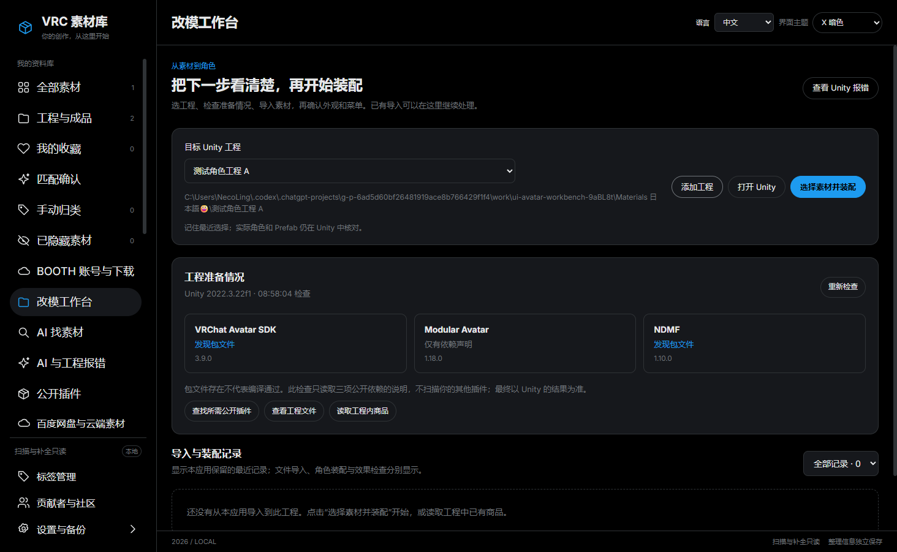
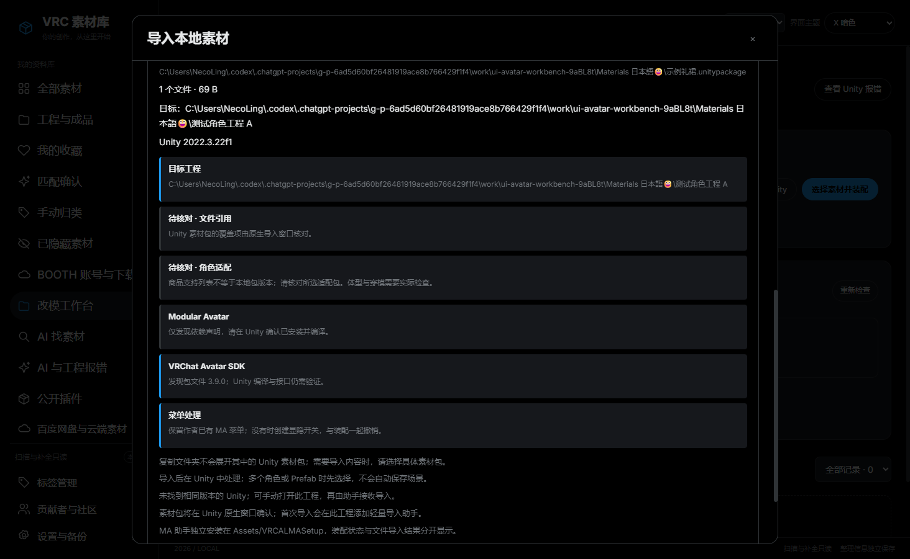
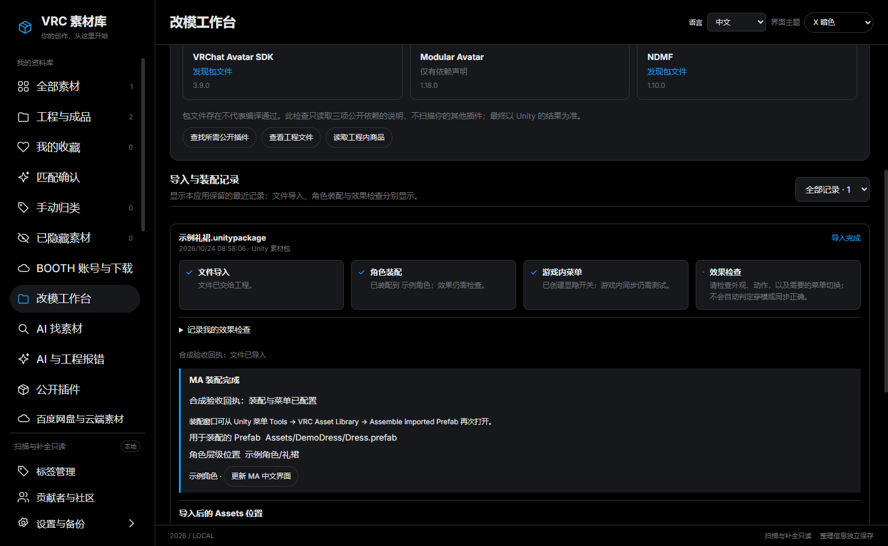
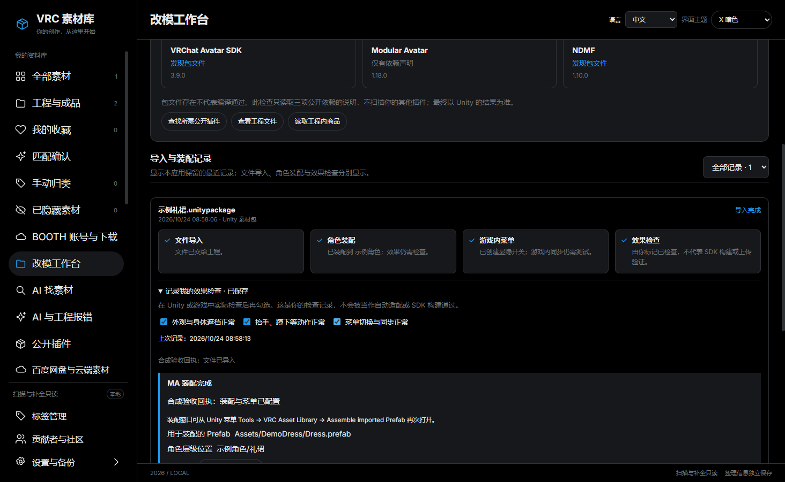
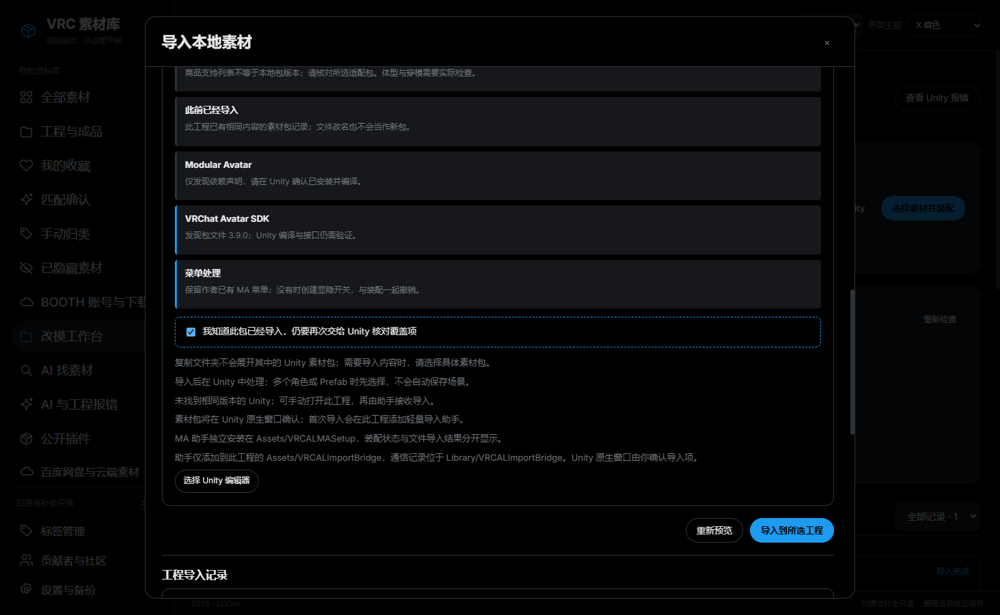

# 改模工作台使用说明

## 添加已有工程（preview.15）

1. 在左侧进入“改模工作台”。
2. 点击“添加工程”，选择同时包含 Assets、Packages、ProjectSettings 的工程根目录；也可以从资源管理器把这一级文件夹直接拖入工作台。一次拖入一个工程。
3. 程序会登记并选中该工程，然后显示依赖检查。工程无需移动，也不必先扫描整个素材库。
4. 以前加入失败或曾标记为缺失的工程，可恢复文件后再添加一次；原有记录和标注沿用。

不要拖入 ZIP 或工程中的 Assets 子目录；本入口需要已经解压的完整 Unity 工程。添加时只读取工程并保存应用记录，不启动 Unity、不安装插件、不自动导入素材。目录链接、资料库/备份重叠仍会被拒绝。

适用版本：1.4.0-preview.5 公开预览。截图拍摄于 preview.4 隔离测试，工作台操作沿用，最新导航见页面整理说明。新增界面暂为中文。

工作台把工程检查、素材导入、MA 装配和结果检查放在同一个页面。下面截图来自实际应用窗口，内容是专门制作的隔离验收样例；“完成”截图使用模拟 Unity 回执演示状态，不代表某件商业衣服已经试穿成功。

## 先认识四个词

| 名称 | 是什么 | 例子 |
|---|---|---|
| 素材 | 下载到电脑的衣服、头发、饰品等文件 | 一个文件夹或 `.unitypackage` |
| 工程 | Unity 用来编辑角色的一整个文件夹 | 内有 `Assets`、`Packages`、`ProjectSettings` |
| Prefab／预制件 | 作者在 Unity 中预先组装好的对象 | 衣服文件夹里的蓝色方块对象 |
| MA | Modular Avatar 插件 | 帮衣服接到角色骨骼、合并菜单等 |

“导入”把文件交给工程；“装配”把预制件放到场景中的角色上；“游戏内菜单”是 VRChat 圆盘里的开关。这是三个不同步骤。角色层级最下面的位置也不是圆盘菜单的位置。

## 1. 进入工作台，选工程

1. 打开应用，在左侧点击 **改模工作台**。
2. 点击 **目标 Unity 工程** 下拉框，选择要修改的工程。
3. 看下拉框下面的完整路径，核对没有选到另一个同名角色工程。
4. 没有想要的工程，点 **添加工程**。选择包含 `Assets`、`Packages` 和 `ProjectSettings` 的那一层，不要单独选择 `Assets`。
5. 应用记住最近选择。只有一个可用工程时可自动选中；多个工程时不会随便挑一个。

## 2. 看懂工程准备情况

| 提示 | 代表什么 | 接下来怎么做 |
|---|---|---|
| 发现包文件 | 发现指定公开依赖的包说明文件 | 仍需让 Unity 编译；不代表接口一定可用 |
| 仅有依赖声明 | 工程写着需要这个插件，尚未找到可验证的包文件 | 在 VCC／ALCOM／Unity 核对是否装好 |
| 尚未确认 | 当前线索不足 | 可点 **查找所需公开插件**，查看作者安装说明 |

这里仅核对 VRChat Avatar SDK、Modular Avatar 和 NDMF 的公开包说明，不检查你所有插件的代码。缺少线索不会阻止文件导入；真正装配时，Unity 助手还会检查它所需的接口。

**重新检查** 更新本页线索。**查看工程文件** 浏览 Assets。**读取工程内商品** 查找工程里已有的素材与商品线索。它们不会把“文件存在”当成“角色正在使用”。

## 3. 选择素材，先看导入预览

1. 点 **选择素材并装配**。
2. 在弹出的窗口里，搜索并点击要导入的本地素材。如果素材尚未入库，先关闭窗口，用顶部 **手动添加素材** 添加文件或文件夹。
3. 如果一个文件夹包含多个适配包，在 **选择要导入的文件或适配包** 中明确选择对应版本。多个包不会一起自动导入。
4. 再次看右侧 **目标 Unity 工程** 和路径。
5. 阅读下方 **导入前检查**。显示“待核对”表示程序不知道结果，不表示已经适配成功。

从工作台进入时默认勾选 **导入后用 MA 装配到角色** 和 **同时接入游戏内菜单**。不想自动装配，可以取消勾选；素材右键原有的导入入口继续保留。

“同时接入游戏内菜单”的行为：

- 检测到作者已有 MA 菜单组件：保留原组件，不再生成第二套开关。原菜单是否设置完整，仍需你检查。
- 没有发现作者 MA 菜单：创建显隐开关，菜单辅助对象与衣服对象分开；衣服仍在角色的直接子级最底部。
- 不会自动关闭原衣服，不会猜测身体遮挡形态，也不会替你完成跨角色适配。

**导入后配置 MA 菜单** 是另一个模式，只处理菜单，不做骨骼装配。选它时会取消装配模式。

## 4. 确认导入，等待 Unity

1. 核对后点击 **导入到所选工程**。到这一步才会向选定工程写入文件及本应用的助手。
2. Unitypackage 会交给 Unity 的原生导入窗口。到 Unity 中检查要导入或覆盖的项目，再确认导入。
3. 普通文件复制到工程的独立目录。发现相同 GUID 时会停止复制；不要靠删除 GUID 或 `.meta` 来强行绕过。
4. 未找到正确 Unity 版本时，可使用 **选择 Unity 编辑器**，或手动打开选定工程。
5. Unity 编译期间可能要等待。应用显示 **等待 Unity 确认** 时不等于已导入完成，也不需要重复点击导入。

原素材不移动、不覆盖。工程助手分别放在 `Assets/VRCALImportBridge` 和 `Assets/VRCALMASetup`，请求和回执放在工程的 `Library/VRCALImportBridge`。

## 5. 在 Unity 中装配

满足自动装配条件、且只有明确角色与预制件时，助手会继续处理。有多个角色或预制件时，先在中文 MA 窗口选择；普通未知预制件可能还需要你给出明确的挂点或装配方式。

如果关掉了助手窗口，可从 Unity 顶部菜单 **Tools → VRC Asset Library → Assemble imported Prefab** 重新打开。不要因为窗口关闭就重新导入整个包。

装配成功后，衣服实例位于所选角色的直接子级最底部。菜单辅助对象也在该角色下。**场景不会自动保存**：先检查，满意后再保存。

当前这一笔装配和新建菜单共用 Unity 的一次 Undo。立即撤销可以一起撤回；Unity 关闭、场景切换或后续操作后，不能把它当成永久卸载功能。已经导入到 Assets 的文件不会因为撤销场景装配而自动删除。

## 6. 回应用看四段进度

| 阶段 | 完成需要什么证据 |
|---|---|
| 文件导入 | 文件复制完成，或 Unity 返回对应导入回执 |
| 角色装配 | Unity 返回对应的装配回执 |
| 游戏内菜单 | Unity 返回保留作者菜单或已创建菜单的回执 |
| 效果检查 | 你实际检查后勾选；不会自动判定 |

文件导入成功但 MA 失败时，文件仍然保留。看 **MA 需要处理** 下的原因，使用对应重试或 Unity 入口。旧助手没有返回新版菜单字段时，会要求更新助手并核对结果，不会冒充菜单已完成。

“导入后的 Assets 位置”列出回执中的文件位置。缺少回执路径时，**查找新增／修改位置** 只能给候选位置：同期手动改动也可能被列入，不拿它做自动装配依据。

## 7. 记录真正检查过的项目

展开某条记录的 **记录我的效果检查**，实际确认后再勾选：

1. **外观与身体遮挡正常**：看默认姿态，原衣服是否穿插，身体是否露出，材质是否异常。
2. **抬手、蹲下等动作正常**：静止正常不代表动作正常。检查肩、腋下、腰、裙摆等位置。
3. **菜单切换与同步正常**：检查开关、默认状态和切换后恢复；需要同步时，在实际游戏环境确认。

记录保存在你选择的资料库，重启后保留，可以取消勾选。勾选是你的检查记录，不等于 SDK 构建通过，也不会上传游戏。

## 8. 遇到“此前已经导入”

同一个 Unitypackage 换了文件名，只要内容一样，在同一工程仍会被识别为重复。应用依据最近保留的导入历史检查，并不声称扫描出所有过去手动安装记录。

先查看之前记录，可能只是需要继续 MA 装配。如果确实要重装，勾选 **我知道此包已经导入，仍要再次交给 Unity 核对覆盖项**，再点击导入。Unity 仍会让你核对覆盖项。

普通文件复制继续使用 GUID 冲突检查，不用时间和文件大小冒充内容相同。无 GUID 的普通文件可能被复制到另一独立目录；不会覆盖已有文件。

## 9. 排查与数据保存

- **看报错**：工作台点 **查看 Unity 报错**，自动带入当前工程。日志读取与 AI 分析仍遵守各自设置；工作台本身不把工程文件上传 AI。
- **缺插件**：点 **查找所需公开插件**，查看作者文档和发布页，不要给工程反复安装不同版本试运气。
- **更换资料库位置**：应用自带迁移包含工程导入记录。普通资料库标注备份不包含完整工程导入日志；需要完整保留时，先退出应用备份所选资料库目录及 Unity 工程。
- **列表太多**：在“导入与装配记录”右侧筛选，更多记录可逐批展开。程序当前最多保留最近 100 笔导入历史，并非无限审计记录。
- **不要当成全自动改模**：本版没有角色衣柜互斥、跨重启一键卸载、最终菜单预算分析、跨角色变形或自动修复任意穿模。

研究结论和后续优先级见 [改模改进报告](AVATAR_WORKFLOW_REPORT.zh-CN.md)。
