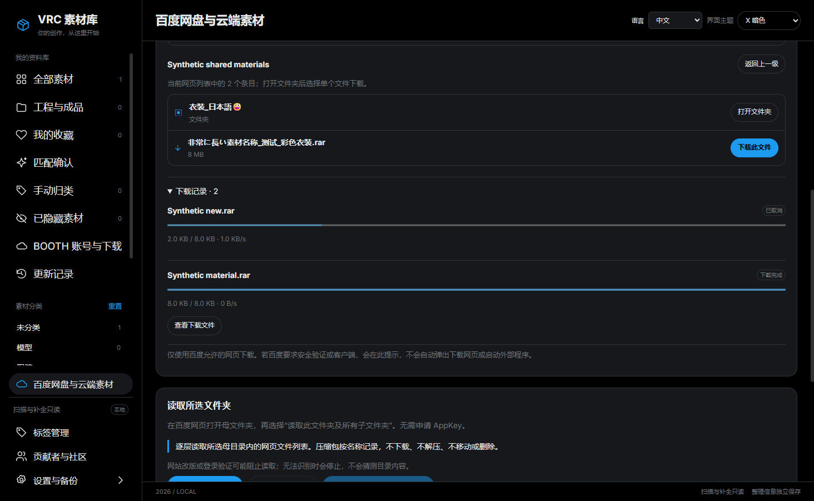

# 百度网盘链接下载（1.3.0）

入口在左侧的 **百度网盘与云端素材**。本页上方的“百度网盘链接下载”负责下载，下方“读取所选文件夹”负责建立云端索引，两者用途不同。

## 1. 先登录

点击 **登录百度账号**。这一步会打开应用内的百度官方登录窗口，在里面扫码或输入自己的账号完成验证。

账号密码和验证码只在百度官方页面填写。不要发给开发者。登录信息只使用本应用自己的会话，保存在你选择的资料库中，不读取其他浏览器的登录状态。

登录完成后关闭登录窗口，回到素材管理器。看到“百度账号已登录”后，链接输入框即可使用。下载操作不会再次弹出百度网页或调用外部浏览器、IDM、百度客户端。

## 2. 粘贴分享文字

在 **分享链接或整段分享文字** 中粘贴别人发给你的百度链接，也可以把带有“链接”“提取码”的整段消息一起粘贴。

一次只输入一个 `https://pan.baidu.com/s/…` 链接。如果链接含有 `?pwd=…`，不用重复填写提取码。如果链接里没有提取码，而分享者给了四位代码，把代码填进下面的 **提取码** 输入框。

点击 **读取分享文件**，等文件列表出现。链接失效、提取码错误、需要验证或页面发生变化时，会显示提示，不会把读取失败当成空目录。

## 3. 选择保存位置

点击 **选择保存文件夹**，选择 C 盘以外的下载位置。不要选择原素材目录或资料库内部。

每次下载会在这里建立一个独立子文件夹，下载完成后保留原文件名，避免覆盖同名文件。下载尚未完成时使用 `.part` 临时文件，不要把它当作完整素材导入 Unity。

## 4. 打开文件夹，选择文件

列表中写着“文件夹”的条目，点击右侧 **打开文件夹** 查看里面的内容。点击 **返回上一级** 可回到上层。

找到需要的文件，点击 **下载此文件**。当前版本一次处理一个文件，不会把整个分享里的文件自动全部下载。

文件列表反映网页当前可读取的条目；超大目录或不支持的页面布局可能无法完整读取。

上图是实际应用界面，素材名称和记录使用合成测试数据。

## 5. 看进度、暂停和定位

- 文件列表上方显示最近一项下载的状态、已下载大小、总大小和速度。
- 展开 **下载记录** 可以查看历史记录。任务正在下载时可点击 **暂停** 或 **取消下载**。
- 已暂停任务在百度仍允许续传时可点击 **继续下载**。
- 显示 **下载完成** 后，点击 **查看下载文件**，资源管理器会定位到这个文件。

记录不会在速度回到零后消失。退出应用或断开账号会停止未完成任务；重启后的中断记录仍保留，但需要重新读取分享并重新下载，不能保证跨重启续传。

下载完成不会自动解压、运行文件或写入 Unity 工程。需要入库时使用“手动添加素材”；需要导入工程时，再使用工程导入功能。

## 常见情况

**提示先登录，明明刚登录过：** 等百度完成跳转，然后回应用再试。如果仍提示，点“重新登录／验证”。账号切换或登录失效会使当前列表失效，需要重新读取链接。

**要求安全验证：** 仅在你主动选择“重新登录／验证”时打开官方窗口。完成后回来重读链接。不会自动弹出下载网页。

**提示百度要求客户端：** 本功能只使用百度网页允许的普通下载，不绕过百度限制。部分文件或账号权限可能无法在应用内下载。已验证登录后的小文件下载，不代表所有分享、大小和文件类型都支持。

**提示保存位置不可用：** 检查磁盘是否连接、是否有空间，选择其他正常文件夹。已存在的文件不会被覆盖。

**换资料库位置：** 使用设置里的资料库迁移，下载历史随迁移保留，已下载文件仍在原保存位置。普通资料库备份不包含百度登录凭证，也不备份下载文件。

新增功能当前以中文为准，完整英语、日语文案将在统一翻译时补齐。
