# VRChat本地素材管理器

零基础图文使用手册 · 1.2.7 · Windows x64

这份手册写给第一次接触本应用的人。你不需要先懂数据库、Unity 工程结构或商品匹配规则。先完成“第一次使用的最短路线”，以后遇到问题再按目录查找，不必一次读完。

**怎样照着做**：引号里的文字是界面按钮或标题；“→”表示先点前一个，再找后一个。每个任务都说明用途、准备、逐步操作、成功后应看到什么，以及出错怎么办。步骤说“确认”之前，先核对当前素材与完整路径。不确定时可以取消。

**截图怎么读**：图片来自实际运行的 Windows 版 1.2.7，使用独立资料库、原创几何封面和明确标注“演示”的空白文件。演示候选不是真实商品。截图中的 W: 是拍摄用临时盘，电脑里没有 W: 很正常。没有使用私人素材、购买记录、真实登录或私人 Unity 工程。MA 装配、网页登录后的页面、实际下载结果和系统回收站恢复未为拍摄执行，相关章节按程序现有流程说明，不以演示截图冒充成功结果。

**版本与文字差异**：截图采用中文界面。主题、窗口大小会影响位置；1.2.7 中“X 浅色”与其他入口中的“X 亮色”指同一套亮色主题。按钮变灰通常表示当前条件还没有满足。新版界面若有变化，以当时按钮和提示为准。

## 先完成这七步，再慢慢学其他功能

1. **下载程序**：从项目 Releases 下载 `VRC-Asset-Library-1.2.7-x64.exe`，不是 Source code。双击 EXE 启动。不会下载时看任务 03。
2. **给整理记录找住处**：第一次选择 C 盘以外的独立文件夹，例如 `D:\VRCAL资料库`。实际资料库会建在它下面的 `VRChatAssetLibrary`。已有资料库要接回原库，不要新建空库。看任务 04。
3. **告诉程序素材在哪**：点“设置与备份 → 素材位置 → 添加素材文件夹”，选择装着素材的母文件夹。子文件夹会继续读取，不用每个都添加。看任务 06。
4. **先学会找文件**：点一张卡片，在右侧详情点“打开路径”。确认它指向你原来的素材。看任务 09、10。
5. **让程序先查商品**：开启“联网”，点“在线补全”，等待任务处理。网络不好也能继续看已有资料。看任务 12。
6. **只处理不明确的结果**：到“匹配确认”核对候选；不合适就用行内“搜索 BOOTH”，进入正确商品点“应用此商品”。认不出可点“跳过自动匹配”。看任务 13-18。
7. **保存一份整理备份**：点“设置与备份 → 备份与恢复”，选择独立备份位置并导出。原素材和 Unity 工程要另外备份。看任务 46。

**已经在旧版确认过商品？先别重做。** 打开“设置与备份 → 资料库数据”核对是不是原资料库。若进入空库，先找回原来含 `library.sqlite` 的文件夹。封面全空也先检查资料库和磁盘，不要立即归因于网络，更不要清空旧库。

## 不同按钮到底会改变什么

| 你要做的事 | 应用里的入口 | 对原素材或工程的影响 |
| --- | --- | --- |
| 把已有内容列进图库 | 扫描、刷新、手动添加、拖入 | 读取并登记，不搬动原素材 |
| 查标题、作者和封面 | 在线补全、确认来源、应用此商品 | 更新整理资料，不等于下载或导入 |
| 暂时不再自动查商品 | 跳过自动匹配／手动归类 | 保留文件和记录，可恢复自动匹配 |
| 常用列表不显示它 | 从资料库隐藏 | 原文件还在；去已隐藏素材恢复显示 |
| 不再读取整个旧路径 | 设置中移除素材位置 | 停用范围；原文件与标注保留 |
| 把真实素材移走 | 删除（移入回收站） | 确认后移动真实文件；恢复须到 Windows 回收站 |
| 把资源放进角色工程 | 导入到工程 | 主动写入所选 Unity 工程；先做工程备份 |
| 让导入预制件成为角色子物体 | 可选 MA 装配 | 改场景；检查后自行保存，支持 Unity Undo |
| 保存整理成果 | 导出备份 | 保存整理信息与封面，不含原文件、工程或登录凭证 |

**五个位置尽量分开**：程序文件夹、原素材文件夹、资料库、备份文件夹、Unity 工程。全文的 D:、F: 都只是举例，替换成自己实际存在的盘。选择“资料库上级文件夹”与最终的 `VRChatAssetLibrary` 文件夹不是同一个层级，以设置显示的完整地址为准。

## 第一部分 · 启动前与界面入门

### 01　先练习鼠标、键盘和窗口

**用来做什么**：看懂后面的操作，不把选择、打开和删除混在一起。

**准备**：以下以鼠标说明，触摸板也可以操作。Ctrl 和 Shift 是键盘上印着对应英文的键；Enter 也叫回车；Esc 通常在左上角；Windows 键印有窗口形标志，通常在键盘下排。

1. 移动鼠标，让箭头指向目标。按一下左键再松开叫“单击”，本说明的“点击”就是这个动作。应用里的按钮、素材卡片和左侧页面都只需单击。
2. 在 Windows 文件资源管理器里，快速连续按两下左键叫“双击”，通常用来打开文件夹或启动 EXE。应用里的候选商品封面单击就会确认，不要为了查看而连续点击。
3. 按一下右键会出现一小块操作列表，叫“右键菜单”。不想操作时，点菜单外空白处，或按键盘左上方的 Esc。上下滚动鼠标中间的小轮子可以阅读长页面。
4. 点文字框后看到闪烁的竖线，就能输入。Ctrl＋A选中框内文字，Ctrl＋C复制，Ctrl＋V粘贴。“＋”表示按住前一个键再按后一个键，不输入加号。
5. 拖入文件时，先在资源管理器中指向文件，按住左键不松，移动到应用窗口内，再松开。普通点击不会产生拖动。

6. 窗口右上角的短横线是最小化，只把窗口收进任务栏；方框是放大或还原窗口；叉形是关闭。想找回最小化的程序，在任务栏点击它的图标。

**成功后看到什么**：能输入、打开和关闭菜单、滚动页面。“复选框”是可以打勾的小方框，“下拉框”点开后能从列表选一项。

**常见误区／失败怎么办**：鼠标指针移到不同位置后，滚轮可能滚动不同区域。先把指针移到要阅读的列表上再滚动。界面太小，可在应用里按住 Ctrl 滚动滚轮；也可到“设置与备份 → 显示大小”选择比例，点“重置为 100%”恢复。

### 02　分清五种东西，再安排保存位置

**用来做什么**：知道哪些是原文件、哪些是整理记录，以及备份能恢复什么。

**准备**：点击任务栏上的黄色文件夹，或按 Windows 键＋E，打开“文件资源管理器”。文件是一个具体项目，文件夹是容纳文件和其他文件夹的容器；`D:\VRChat素材`这样的“路径”是地址，`D:`是磁盘，反斜杠分开各层文件夹。窗口上方显示位置的长条叫地址栏。

1. 找到“程序”：名称类似 `VRC-Asset-Library-1.2.7-x64.exe`。EXE 是运行应用的文件，双击它才会启动管理器。可把它放在自己容易找到、具有写入权限的独立文件夹，避免放进素材目录。
2. 找到“原素材”：例如自己保存的 ZIP、7Z、RAR、Unity 素材包、模型或素材文件夹。本册把这些放在 `D:\VRChat素材`。扫描只是登记位置，不会把它们搬进资料库。
3. 认识“资料库”：保存名称、分类、标签、备注、封面、设置等管理信息，也保存应用运行所需的数据。它与原素材分开；不要自行修改里面的数据库、会话或缓存文件。
4. 认识“工程”：这是供 Unity 打开的工作文件夹，通常一起包含 `Assets`、`Packages`、`ProjectSettings`。一个素材包不是一份完整工程；把包登记到图库，也不等于已经导入 Unity。
5. 认识“备份”：本应用导出的资料库备份包含整理信息和封面，不包含原素材、Unity 工程或登录凭证。原素材和工程需要另行备份。

**成功后看到什么**：能区分程序、原素材、资料库、工程和备份。备份放另一块实际硬盘，对原硬盘损坏时的保护更有帮助；仅换文件夹不能防止整块硬盘损坏。

**常见误区／失败怎么办**：资料库和备份必须放在 C 盘之外，也不能放进要扫描的素材目录。不要选整个 `D:\` 当素材文件夹；请选具体的 `D:\VRChat素材`。已有资料库的用户应找回原来的那个，不要为了进入界面另建一份空库。

### 03　下载并启动正确的程序

**用来做什么**：获得能直接运行的 Windows x64 正式版。

**准备**：Windows x64 电脑、可用网络，以及一个独立的程序保存文件夹。浏览素材不要求安装 Node.js 或 Unity。

1. 在系统浏览器打开项目的[正式发布页面](https://github.com/NecoAya/VRCAL-VRChat-Asset-Library/releases)。找到版本 **1.2.7**，展开该版本下面的“Assets”附件列表；这里的 Assets 是网页的“发布附件”，不是你的 Unity 工程目录。
2. 点击 `VRC-Asset-Library-1.2.7-x64.exe` 下载。名称中的 `1.2.7` 是版本，`x64` 是适用架构。`Source code (zip)`、`Source code (tar.gz)` 是源码，不能当作这个免安装程序双击使用。
3. 等浏览器显示下载完成，打开下载所在文件夹，把 EXE 放到准备好的程序位置，再双击启动。升级时先正常退出旧版窗口，再启动新版。

**成功后看到什么**：资源管理器可能隐藏 `.exe` 后缀，可同时查看“类型”是否为应用程序。首次使用会出现资料库位置选择窗口；已经登记过有效资料库的电脑通常会直接进入主界面。

**常见误区／失败怎么办**：下载中不要启动。系统若拦截，先核对来源、文件名和提示，不把关闭系统防护当作安装步骤。没有预期窗口时，检查旧版是否仍开着、下载是否完整，保留错误文字便于求助。

### 04　首次选择资料库，进入主界面

**用来做什么**：告诉程序以后把整理记录和设置保存在哪里。

**准备**：在 C 盘之外准备一个空的上级文件夹，例如 `D:\VRCAL资料库`。它不能位于 `D:\VRChat素材` 里面。不会新建时，按 Windows 键＋E 打开资源管理器，点“此电脑”，双击一个实际存在的非 C 盘；按 Ctrl＋Shift＋N，输入“VRCAL资料库”，按回车。这样只新建空文件夹，不会搬动素材。

1. 在标题为“选择资料库保存的上级文件夹（C盘之外）”的窗口里，找到 `D:\VRCAL资料库`。看清地址栏后再确认选择。
2. 程序会创建 `D:\VRCAL资料库\VRChatAssetLibrary`，并自动重新启动一次。这个重启是正常流程，等主界面出现，不必连续双击 EXE。
3. 点击左下角“设置与备份”，找到“资料库数据”，核对完整路径。记下这个位置，再点“完成”关闭设置。

**成功后看到什么**：“资料库数据”显示实际路径。没有素材卡片时，还需要添加素材位置。

**常见误区／失败怎么办**：已有资料库却提示无法打开时，先接好原磁盘，再按提示“重试原位置”或“重新定位已有资料库”。找包含 `library.sqlite` 的原资料库文件夹，不要随便选择一个同名空文件夹，也不要删除旧库来消除提示。

### 05　认识主界面各个区域

**用来做什么**：知道按钮在哪，能按自己的目的找到入口。

**准备**：点左侧“全部素材”。

1. 看左侧导航。“全部素材”浏览登记的素材；“工程与成品”看工程；“我的收藏”看点过爱心的条目；“匹配确认”核对候选商品；“手动归类”整理不继续自动匹配的素材；“已隐藏素材”找回隐藏条目。“BOOTH 账号与下载”与“更新记录”是另外的页面。
2. 继续往下看。“素材分类”按类别缩小范围，旁边“重置”清除分类选择；“集合与智能视图”是自己组织的查看方式，不会因此搬动磁盘文件。底部还有“百度网盘与云端素材”“标签管理”“贡献者与社区”和“设置与备份”。本册先使用本地素材入口。
3. 看上方工具栏：页面标题与数量、语言和主题，以及“手动添加素材”“刷新素材”“在线补全”。“撤回来源”和“撤销整理”在有对应记录时才出现，二者处理的事情不同。
4. 看中间上方的搜索框及筛选栏，再看下方素材卡片区。卡片上的图片叫封面；标题、作者、标签、本地适配和状态帮助识别内容。右侧“素材详情”用于查看一个条目的资料和修改标注。
5. 留意扫描、联网任务的状态区和操作后的提示文字。任务仍在进行时，有些按钮会暂时变灰，表示当前不能点击。

**成功后看到什么**：点击左侧页面后，标题和内容变化；点击素材卡片查看详情。数量是应用记录统计，不是购买数量，也不一定等于磁盘文件总数。

**常见误区／失败怎么办**：某区域不见时，先把窗口放大或用滚轮向下看。详情被收起时，找筛选栏右侧“展开详情”按钮；把鼠标停在图标上稍等，会出现名称提示。

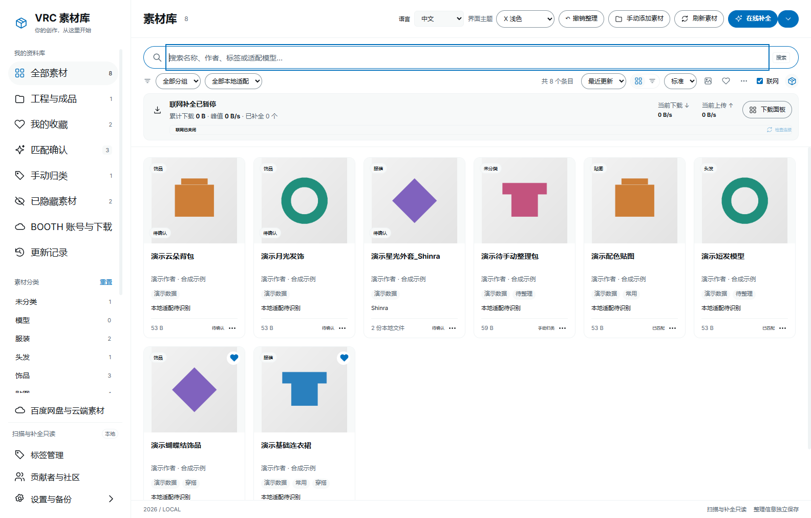

## 第二部分 · 登记与浏览本地素材

### 06　添加母文件夹，递归扫描全部子文件夹

**用来做什么**：把整批按文件夹保存的素材纳入长期扫描范围。“递归”就是继续进入里面的子文件夹逐层查找。

**准备**：原素材在 `D:\VRChat素材`，资料库和备份在它外面。扫描不解压素材包，也不导入工程。

1. 点击“设置与备份”，找到“素材位置”，再点“添加素材文件夹”。
2. 在“添加素材目录”窗口选择 `D:\VRChat素材`。这里选择的是装着多份素材的母文件夹，不需要逐一打开每个子文件夹。
3. 确认后看“素材位置”是否出现这条路径，点“完成”回到图库，等待扫描。程序会读取子目录；分类容器不会简单变成每个内部文件一张卡，Unity 工程会作为整体识别。

**成功后看到什么**：出现扫描进度，素材逐步进入图库。已经登记子目录后再添加其母目录，列表会由母目录统一覆盖，原素材不需要搬动。

**常见误区／失败怎么办**：程序默认可能列有 `E:\VRChat`，不是要求你把文件搬过去。添加自己的位置后，不用的登记路径可点旁边“移除”；这只停止纳入该路径，保留原文件和标注。若提示母目录包含资料库或备份，先在设置迁移它们，不要把素材目录和资料库混放。

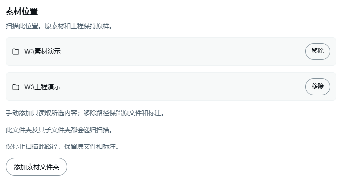

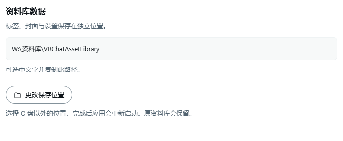

### 07　只登记一份素材：手动添加或拖入

**用来做什么**：不扫描整个母目录，只把手头这一份包或文件夹加入图库。

**准备**：找到具体素材，例如 `D:\VRChat素材\演示服装.zip` 或一份独立素材文件夹。不要选择磁盘根目录、程序目录、资料库或备份目录。

1. 添加文件夹时，点顶部“手动添加素材”。在“选择素材文件夹（可多选）”窗口选择具体素材文件夹并确认；这个窗口选文件夹，不是直接挑 ZIP 文件。
2. 添加 ZIP、7Z、RAR、`.unitypackage` 等支持的素材文件时，在资源管理器中选中它，按住左键拖到应用窗口内再松开。文件夹也能这样拖入。
3. 等待“正在添加…”结束，查看“已添加…个，已更新…个”的提示。如果提示有未添加项目，阅读对应读取提示，再决定如何处理。

**成功后看到什么**：图库显示新登记内容，设置的路径旁可能标出“手动添加”。它只读取所选内容，不复制、解压或执行包里的文件。

**常见误区／失败怎么办**：正在扫描时先等待完成或“停止扫描”，再添加。每次只选少量需要的文件；一次最多接受100个所选文件或文件夹。完整 Unity 工程可以整体添加，工程内部文件应通过工程的“读取工程内商品”查看，避免重复当成下载包登记。快捷方式、目录链接及不支持的文件可能被拒绝。

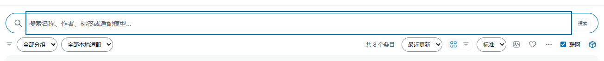

### 08　文件有变化后，点击刷新素材

**用来做什么**：重新读取已登记位置中的新素材、改动和文件是否仍在原处。

**准备**：外接盘已连接；原素材仍保存在登记路径中。

1. 点击顶部“刷新素材”。扫描时按钮显示“扫描中”，状态区会显示“正在扫描”和已找到的数量。
2. 等扫描完成再继续批量整理。确实需要中断时，点进度区的“停止扫描”，随后可再次刷新。
3. 查看新条目和缺失提示。若刚把文件从回收站还原到原路径，也在这里刷新。

**成功后看到什么**：图库反映本次读取结果。包装层或同一商品的多份本地内容有时会集中成一张卡，卡片显示“几份本地文件”，详情仍能看到各自路径。

**常见误区／失败怎么办**：“刷新素材”不是“在线补全”，不会因为刷新就保证获取商品封面。文件缺失也可能只是移动硬盘没连接；先接回磁盘、核对路径。不要为了清除缺失提示删标注。合并展示不代表磁盘里的重复文件已经删除或合并。

### 09　用搜索和筛选找到素材

**用来做什么**：从许多条目中缩小到需要的那几份。

**准备**：先点“全部素材”，确认不是还停在某个集合或隐藏页。

1. 点“搜索素材”框，输入名称、作者、标签或适配模型线索。输入后列表会更新，通常不需要再按回车。先用短而明确的关键词，例如“演示”。
2. 按需要选择“角色分组”“本地适配模型”或左侧“素材分类”。这些条件会一起生效，所以条件越多，结果通常越少。
3. 点筛选栏三个点的“更多筛选”，可按标签、作者、状态、封面、收录日期筛选，也能勾选“只看未添加标签的素材”。完成后点“关闭筛选”。
4. 想重新开始时，点搜索框右端的叉形“清空搜索”，把分组和适配改回“全部分组”“全部本地适配”，点分类“重置”；更多筛选内点“清除更多筛选”。

**成功后看到什么**：“共…个条目”随条件变化。卡片上的“命中”文字可帮助理解为什么找到这个结果。结果多时向下看“加载更多”；图库可切“网格视图”“列表视图”，并按需要改变排序和“内容密度”。

**常见误区／失败怎么办**：“没有找到相符的条目”先检查筛选，不要立刻重新添加所有素材。普通搜索不负责从互联网下载新素材；隐藏条目请去“已隐藏素材”页搜索。“保存当前筛选”的爱心图标保存的是智能视图，卡片上的爱心才是收藏单个素材。

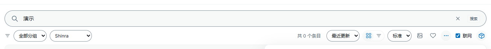

### 10　查看封面、详情和文件位置

**用来做什么**：确认选的是哪份素材，找到它在磁盘上的位置。

**准备**：图库中已有一张演示素材卡片。

1. 单击卡片，打开右侧“素材详情”。“信息与标注”显示资料；“文件列表”只读查看目录或包内能识别的条目。阅读长详情时，把指针移到详情区域再滚动。
2. 在“本地信息”点“打开路径”，Windows 会定位原文件所在位置；点“复制”只是复制完整路径文字。关闭资源管理器窗口不会删除文件。
3. 需要自定图片时，点大封面上的“更换封面”，在“选择素材封面”窗口选择本地图片。支持 PNG、JPG、JPEG、WebP、GIF、BMP；程序复制图片到自己的封面存放处，不替换素材包内容。
4. 卡片爱心按钮可“收藏”或“取消收藏”。详情顶部左右箭头可查看上一项、下一项，叉形按钮“收起详情”可收回面板。

**成功后看到什么**：详情标题和路径对应当前素材；封面改变或收藏标记生效。封面边缘显示不全时，点筛选栏的图片形按钮，切换“完整显示封面”与“封面填满画框”。这只改变显示方式。

**常见误区／失败怎么办**：商品封面不是本地文件已经打开或导入的证明。“文件列表”显示截断提示时，用“打开路径”查看完整目录。缺失文件会提示“原文件暂时无法找到；你的标注仍然保留”，先处理磁盘与路径，不必重做标注。

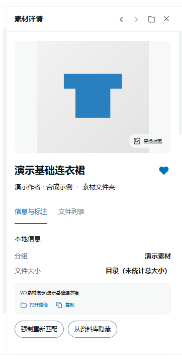

### 11　写自己的标注，理解适配对照

**用来做什么**：给素材写容易记住的名字、分类和备注，并区分商品宣传的适配与本地识别到的版本。

**准备**：单击素材卡片，打开详情的“信息与标注”。

1. 向下找到“我的标注”，按需要填写“显示名称”“分类”“自定义标签”“我确认的适配模型”“备注”。多个标签或模型名称用逗号分隔，例如“日常，夏日”。只填自己确实知道的内容。
2. 点“保存标注”。看到“未保存”时说明改动尚未提交；先保存再切换条目。显示名称是应用里的名称，不会因此重命名磁盘文件。
3. 查看“适配对照”中的“本地适配”和“BOOTH 商品适配”。需要知道依据时展开“查看本地识别依据”，阅读文件名或压缩包内名称。

**成功后看到什么**：保存后的标注在详情和相关卡片显示，并可用于搜索。“本地适配”综合本地识别与人工确认；“尚未发现本地版本”表示商品支持列表里有该模型，但当前没有对应本地证据。

**常见误区／失败怎么办**：灰色不等于已经证实缺文件，名称识别可能不完整。识别到适配名也不等于实测穿戴成功，更不保证工程依赖齐全。不要仅因为商品页写支持，就填写“我确认的适配模型”；应核对自己这份文件。匹配确认页1.2.7收起了适配串，需要比较时回图库详情。

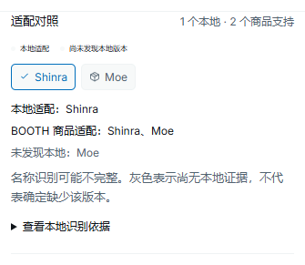

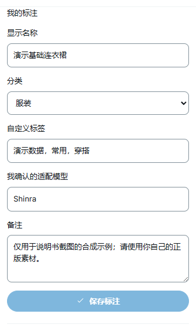

## 第三部分 · 自动匹配与手动确认

### 12　看懂匹配状态，再开始在线补全

**用来做什么**：给本地素材查找公开商品标题、封面等资料，同时知道哪些结果还需要核对。

**准备**：能上网，已经把素材加入图库。离线浏览和人工写标注不需要开启联网。

1. 在筛选栏勾选“联网”，或到“设置与备份 → 网络与代理”勾选“启用在线补全”。程序使用系统代理设置；这里不会代替你配置系统网络。
2. 没有勾选素材时，点顶部“在线补全”查找尚待补全的素材。有勾选项时，按钮针对所选素材重试；操作前先看已选数量，避免误以为在处理整库。
3. 查看任务状态，给网页请求留出时间。需要重新检查旧的未匹配结果时，点“在线补全”旁的小下拉箭头，再点“重试未匹配”；它保留已经匹配的商品。

4. 点状态区右边的“下载面板”，查看“当前请求”、素材名、公开链接、速度曲线和“最近读取与下载”。请求很快结束时，可在最近记录继续看大小、平均速度和耗时；当前显示 0 B/s 不等于任务丢了。
5. 面板出现“暂停补全”时可点击暂停，稍后点“继续补全”。只暂停补全与关闭整个“联网”开关不同；关闭联网还会影响官方网页、下载与其他联网功能。
6. 面板“并发任务数”或设置“网络与代理 → 下载并发任务数”可选 1-6，默认 3。网速不稳先保持默认或调低。BOOTH 网页仍按请求间隔读取，不会因为调高就绕过网站限制；这里补全下载的是商品网页和封面，BOOTH 原素材包另看任务 39。

**成功后看到什么**：条目可能获得标题、作者、封面和候选，但不保证每份都能找到。详情的状态包括“等待补全”“已匹配”“待确认”“未找到来源”“稍后重试”“访问受限”；卡片会使用更短的“待补全”“未找到”“需重试”。“人工确认”“人工提供”表明有人工来源操作，不代表网站验证了你的文件。

**常见误区／失败怎么办**：“待确认”应去核对候选；“未找到”可以改线索、用BOOTH搜索或手动归类；失败、超时、访问受限先看提示与网络，稍后再试，连续点击不会让网站验证消失。补全不会上传素材包或Unity工程，也不会替你购买、下载原商品或证明本地素材授权。

### 13　在匹配确认中核对候选

**用来做什么**：在名字相似或证据不够明确时，由你决定哪款商品对应本地素材。

**准备**：左侧“匹配确认”有待确认条目；联网已开启。先从自己能认出的素材开始。

1. 点击“匹配确认”。每行左边是本地素材，右边是候选商品。先核对左边文件名，再看右边商品名、作者、图片及依据，不能只看封面好不好看。
2. 需要了解商品时，先点候选的“预览网页”。确认内容对应后，再点“使用此商品”；直接点候选封面也会执行确认，封面不是单纯放大图片的按钮。
3. 明显不是这份素材的候选可点“排除此商品”。之后发现排除错了，可用“恢复已排除 · …”恢复记录并重新匹配。没有可靠候选时，使用下一节的BOOTH搜索，或先跳过。
4. 本页处理完点“下一页”。可用“素材顺序”切换文件修改时间、入库时间或名称；想重新读取批次时点“刷新待确认列表”。

**成功后看到什么**：确认后提示“商品来源已确认”，这一行从待确认页移除；其他行不会因为这次确认自动补入新条目。每页最多10行，候选图尚未显示时可点“加载本页预览图”，或单项“加载候选封面”，等待队列读取。

**常见误区／失败怎么办**：文件修改时间不是购买时间；入库时间是首次登记时间。页面显示“本页已核对完”不等于整库都已匹配。误选商品后先用“撤回来源”，不要删除素材解决来源错误。网站验证需要按页面要求完成，预览失败不代表本地文件损坏。

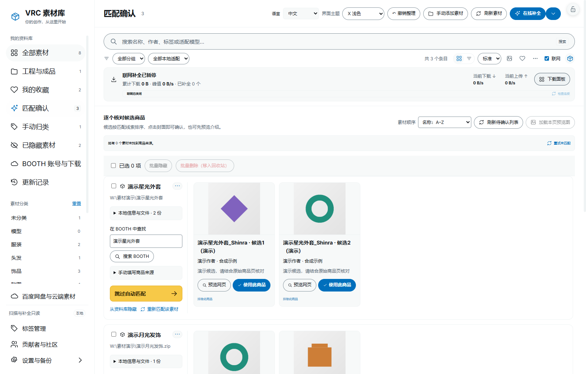

### 14　用内置BOOTH搜索，再应用商品

**用来做什么**：自动候选不合适时，自己在BOOTH查找并关联正确商品。

**准备**：开启联网；知道一点商品名、作者或编号。选择的是你当前要确认的本地素材行。

1. 在该行“在 BOOTH 中查找”的输入框里，保留或修改搜索词。可以输入商品名、作者或已核对的编号，再点“搜索 BOOTH”。
2. 内置浏览器打开后，先看工具栏关联的本地素材是否正确，再在BOOTH搜索结果中打开对应商品详情。检查商品名称、作者和内容。
3. 确定对应后，点浏览器本地工具栏里的“应用此商品”。要应用的是正在有效加载的BOOTH商品详情页，不是搜索列表、店铺首页或网站错误页。

**成功后看到什么**：该商品来源关联到先前那份本地素材；回到应用可查看相应来源。它属于人工确认，可通过“撤回来源”恢复前一状态。

**常见误区／失败怎么办**：应用商品不等于购买或下载，也不检查本地包与商品是否真的一致，仍要你判断。“应用此商品”不可用时，先确认已进入商品详情并正常加载；遇到登录或验证，按BOOTH官方页面操作，不把密码贴进素材搜索框。不要在浏览器切换商品后忘记核对当前关联的本地素材。

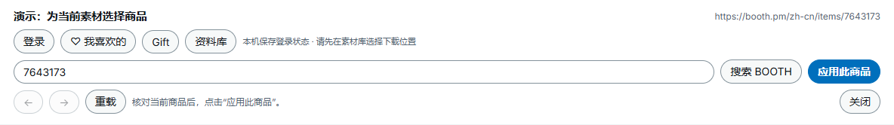

### 15　已有网址或编号时，手动填写商品来源

**用来做什么**：不用在候选里寻找，直接把自己核实过的商品来源交给程序读取。

**准备**：从对应商品详情页复制公开HTTPS网址，或复制有效的BOOTH商品编号。示例图片里的编号不可当作自己的素材来源。

1. 在“匹配确认”的素材行点击“手动填写商品来源”，展开输入区。
2. 在“商品网址或 BOOTH 编号”框粘贴网址，或输入1-12位有效BOOTH编号。编号必须大于零；不要填订单号、价格、日期、压缩包版本号或账号密码。
3. 再核对本行素材和来源，点“读取并采用来源”。这是采用来源的操作，不只是保存一个备用搜索词。
4. 若从图库详情操作，点击“粘贴商品链接”或“修改来源”，在“商品网址”中填写完整公开HTTPS链接，再点“保存”。这个详情弹窗要求网址，不能只填编号。

**成功后看到什么**：来源登记并进入读取或补全流程，后续资料取决于网页能否访问。可在详情查看来源，并用“打开商品页面”检查。仅提交输入并不能保证封面马上出现。

**常见误区／失败怎么办**：输入无效会显示提示；先检查前后空格、是否漏了`https://`，网址是否真的是商品页。不要粘贴含登录验证信息或临时下载参数的私有链接。网页拒绝访问时先保留已知资料，稍后再试；来源填错可撤回。

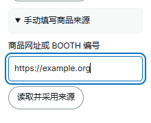

### 16　来源选错了，使用撤回来源

**用来做什么**：撤回最近一次商品来源确认，恢复此前的来源和候选。

**准备**：刚才使用了候选、BOOTH应用或手动来源操作，界面有“撤回来源”按钮。

1. 找到顶部或匹配确认页的“撤回来源”。先看它指向的素材标题；把鼠标停留在按钮上，可查看撤回哪次来源的提示。
2. 确认是需要撤回的那次，再点击。等待“正在撤回…”结束。
3. 回到对应素材查看来源；如果它恢复为待确认，继续核对合适的候选。

**成功后看到什么**：该次来源前的联网资料和候选恢复，其他人工标注保留。来源历史可跨重启使用，但只保存有限的最近记录；从资料库备份恢复后，之前的来源撤回历史会清除。

**常见误区／失败怎么办**：“撤销整理”用于整理标注，与“撤回来源”不同；两者都不是Windows回收站的文件还原。提示记录失效时查看最新记录，不要反复点旧按钮。没有撤回按钮时，仍可从详情“修改来源”重新指定正确商品，但不会凭空恢复已不存在的历史。

### 17　使用1.2.7顶部锁定、折叠和跳过

**用来做什么**：给确认内容腾出空间，或在需要频繁搜索时保留顶部控制。

**准备**：进入“匹配确认”，有足够内容可以上下滚动。

1. 看右上角小锁。默认是开口的锁，名称“锁定顶部区域”；此时向下滚动，标题、搜索、筛选和下载状态会随确认内容滚走。
2. 点击小锁变为锁定。顶部保持可见，按钮名称变为“解锁顶部区域”。再点可恢复随内容滚动；选择会自动保存，重启和正常备份恢复也能保留。
3. 窗口较窄时，锁定顶部最多占确认工作区域约45%，顶部内容可独立滚动。将鼠标放到顶部滚动看控制，移到候选区滚动看素材，两处不是同一滚动位置。
4. 想看时间、完整路径、多份本地文件和匹配依据时，展开“本地信息与文件 · …份”；手工网址输入展开“手动填写商品来源”。“搜索 BOOTH”始终保留在行内，但联网关闭时不能发起搜索。
5. 暂时无法确认或不想自动匹配时，点行底部醒目的整行“跳过自动匹配”，稍后去左侧“手动归类”继续整理。

**成功后看到什么**：切换锁定时保留当前素材位置与顺序；折叠只收起信息，不删除资料。跳过后本行退出确认页，原文件及标注保留。

**常见误区／失败怎么办**：锁定不表示锁定素材或禁止编辑，也不是让窗口始终盖住其他程序。“跳过自动匹配”不等于隐藏，更不等于删除；它会改变后续匹配方式。确认页不再显示一长串适配名，需要时回到素材详情的“适配对照”。

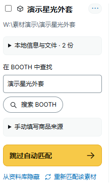

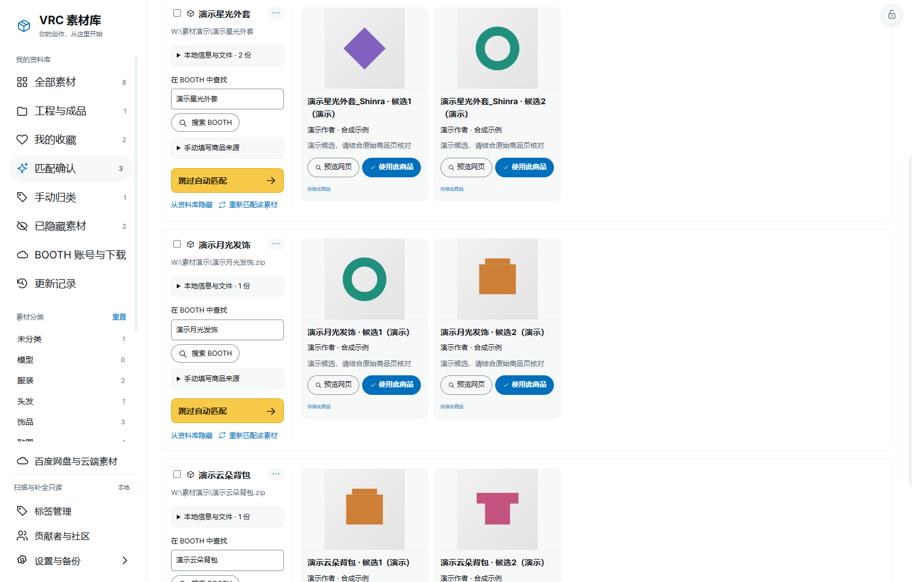

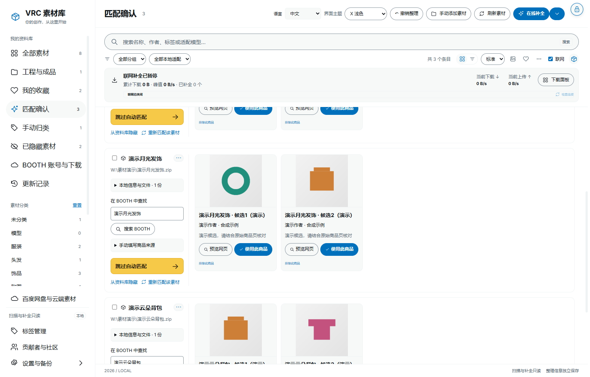

### 18　在手动归类里继续整理

**用来做什么**：管理无法确认来源、自制或暂时不想自动匹配的素材，仍然能写名称、标签和备注。

**准备**：已有跳过的素材；也可以从普通素材详情的“商品来源”区点“移至手动归类”。

1. 点击左侧“手动归类”，用搜索和分类找到条目。
2. 单击条目，在“我的标注”里填写自己的名称、分类、标签和备注，再点“保存标注”。手动归类不会要求先有商品链接。
3. 以后希望继续自动查找时，在该素材详情的“商品来源”区点“恢复自动匹配”，开启联网后按需要重新补全。

4. 已确认过但想完整重找时，右键这份素材，点“强制重新匹配”；也可在详情“本地信息”点同名按钮。它会切到匹配确认，保留旧资料，供你核对新候选；与普通“刷新素材”不同。
5. 在确认行点“重新匹配该素材”可重新提交检索，再用 BOOTH 搜索或手动来源选择新商品。开启可选闲鱼辅助搜索的方法见任务 42。选错新来源仍可按任务 16 撤回。

**成功后看到什么**：卡片显示“手动归类”；素材继续在应用中可查找，原文件位置不动。恢复自动匹配后，不再作为跳过自动匹配的素材管理，后续是否出现候选仍取决于结果。

**常见误区／失败怎么办**：手动归类是应用中的整理方式，不会建立同名磁盘文件夹。素材不见时清除本页筛选，再检查“已隐藏素材”；不要重复拖入来代替查找。只有确认适合时再用“强制重新匹配”，它会重新送入确认流程，不是简单刷新文件位置。

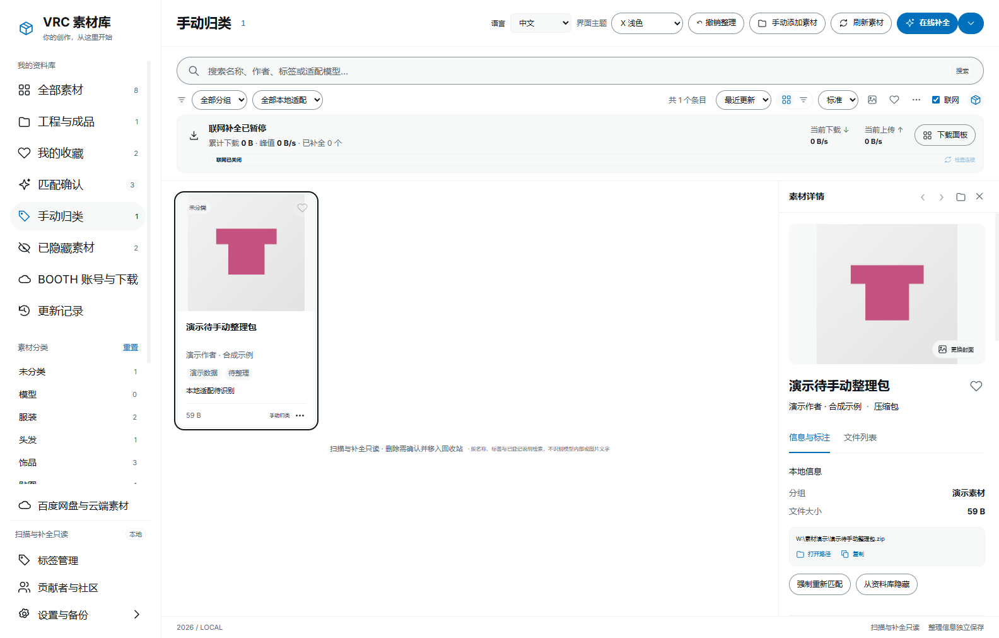

## 第四部分 · 批量整理、隐藏与回收

### 19　多选、批量操作和取消选择

**用来做什么**：对几份素材一起整理，减少重复操作。

**准备**：先在图库用搜索或筛选缩小到容易核对的范围。第一次操作先选两份演示条目。

1. 点击每张卡片上用于选择的小方框，出现勾后即被选中。也可按住Ctrl再点击多张卡片；按住Shift点击另一张可连续选择两者之间的范围。
2. 看上方“已选…项”是否符合预期。图库批量栏有“批量标签”“修改分类”“收藏”“移除标签”“加入集合”“批量隐藏”和“批量删除（移入回收站）”等；先选需要的，再点对应操作。
3. 不继续批量处理时，点“取消选择”。“匹配确认”每行也有选择框，顶部可“选择本页素材”，用于本页批量隐藏或删除。

**成功后看到什么**：卡片显示选择状态，数量变化。选中本身不会改动文件。

**常见误区／失败怎么办**：全选入口通常针对当前已显示或本页条目，不等于选中整个资料库。“删除”会处理真实路径，不能因为已选数量小就省略核对；一张合并卡片可能对应多份本地文件。右键菜单可以自定义，某项不见时可用页面固定按钮或“设置右键菜单”查看。

### 20　暂时不想看到：从资料库隐藏

**用来做什么**：把条目从常用图库中收起，保留原文件、封面和标注。

**准备**：确定只是暂时不显示，而不是想释放磁盘空间。

1. 单项可在详情“本地信息”点“从资料库隐藏”；也可右键卡片，在菜单点同名操作。匹配确认行也提供“从资料库隐藏”。
2. 多项先勾选，再点“批量隐藏”。留意提示“已从资料库隐藏，可在‘已隐藏素材’中恢复”。
3. 点击左侧“已隐藏素材”，确认条目在那里。

**成功后看到什么**：条目离开普通图库或待确认列表，隐藏页数量随之变化；磁盘文件仍在原处。隐藏页按应用合并后的条目计数，不能把这个数字当作磁盘文件份数。

**常见误区／失败怎么办**：隐藏不会减少原素材占用的磁盘空间。想找回条目请去独立隐藏页；1.2.7设置里只有“查看已隐藏素材”短入口，不再放一长列隐藏记录。“取消”删除确认也不是隐藏操作，取消应保留原状态。

### 21　在独立隐藏页搜索、定位和恢复

**用来做什么**：集中管理隐藏条目，恢复单项或多项显示。

**准备**：左侧“已隐藏素材”有记录；原素材所在磁盘已连接。

1. 点击左侧“已隐藏素材”。在“搜索名称或路径”框输入素材名或路径片段；这里搜索隐藏列表，不沿用普通图库的搜索框。
2. 点条目“打开所在文件夹”可定位原文件。若有“本地文件 · …份”，展开查看合并条目的其他路径。
3. 恢复一项点“恢复显示”；恢复多项先勾选，再点“恢复所选（数量）”。“选择已显示条目”只选当前已加载的记录。
4. 需要更多条目时向下点“加载更多”。超过页面显示上限时按名称或路径缩小范围；没有结果可“清空搜索”。

**成功后看到什么**：提示“素材已恢复显示”，条目离开隐藏页，回到适合它当前状态的普通图库、手动归类或匹配流程。原有标注继续保留。

**常见误区／失败怎么办**：已移入回收站的文件不会当作隐藏条目列在这里。移除过素材来源路径后，其记录仍保留但当前隐藏页可能不展示；先到设置重新加入原路径。读取失败可点“重新读取资料库”。恢复显示后仍找不到时，先回“全部素材”清除搜索筛选。

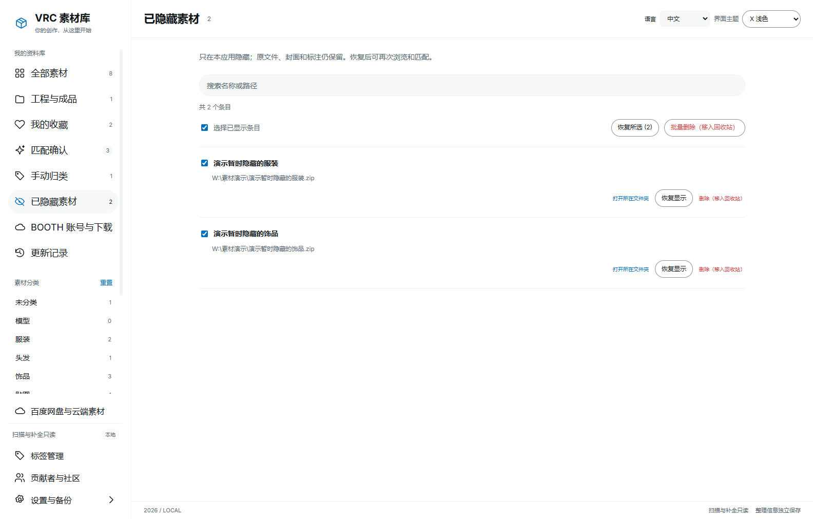

### 22　确实不要原文件：移入Windows回收站

**用来做什么**：让Windows把所选原素材移入系统回收站。此操作会改变磁盘上的文件位置，务必核对。

**准备**：不确定的素材先隐藏。要删除时，确认选中的正是准备处理的素材，重要原件已经另外备份。

1. 普通图库可右键卡片点“删除（移入回收站）”；批量先勾选再点“批量删除（移入回收站）”。隐藏页也有这两个入口。
2. 阅读“删除素材（移入回收站）”确认窗口。它会列出真正要处理的完整路径：文件夹里面的文件会一起处理，合并卡片可能列出多个路径。
3. 任何一条拿不准就点默认的“取消”。确认全部正确才点“移入回收站”，等待结果，再查看成功、失败或未处理提示。

**成功后看到什么**：成功项的原文件进入Windows系统回收站，不再作为正常素材显示；应用保留相关封面和人工标注。批量操作可能部分成功，不能只看总提示就认为每项都完成。

**常见误区／失败怎么办**：共享扫描根、资料库和缓存会话、Unity工程及内部文件、目录链接等受保护；被拒绝时按提示缩小范围，不要尝试绕过保护。独立手动添加的素材也可能允许回收，所以不能认为所有登记目录都绝不会被删除。系统回收失败时程序不会自动改为永久删除；先检查提示及原路径。

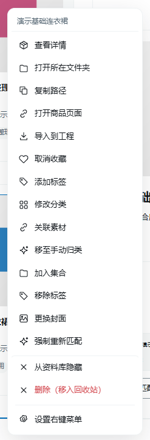

### 23　从回收站还原到原路径，再刷新

**用来做什么**：找回刚才回收的实际文件，并让应用重新识别。

**准备**：文件仍在Windows回收站，尚未清空。原磁盘可用，原路径没有被另一份同名内容占用。

1. 在Windows桌面打开“回收站”，按名称、原位置和删除时间核对项目。只选本次准备恢复的素材，不必“还原所有项目”。
2. 右键所选项目，点Windows的“还原”。Windows会尝试放回原来的位置；若提示路径冲突，先停下核对，不能随意覆盖现有文件。
3. 回到管理器点“刷新素材”。必要时把已经还原到原位置的素材重新拖入；外接盘须先接好。
4. 原来已经隐藏的条目，还原文件后仍保持隐藏。到“已隐藏素材”点“恢复显示”，才能再次出现在普通图库。

**成功后看到什么**：在资源管理器中能找到原路径下的文件；应用刷新后相应记录可恢复使用，标注继续关联。应同时检查磁盘文件和应用界面，不能仅凭一条成功提示判断全部内容已经找回。

**常见误区／失败怎么办**：“撤销整理”和“撤回来源”都不会从系统回收站还原文件；资料库备份也没有原素材。回收站已经清空时，需要你另外保存的原文件备份或重新获取原素材，本应用不能保证找回已永久删除的数据。日常先小批量整理，核对无误后再处理更多条目。

## 第五部分 · 标签、收藏与集合

### 24　给单个素材加标签、备注和收藏

这一节与任务 11 使用相同入口。第一次操作先按任务 11 填写“我的标注”并点“保存标注”；收藏点击卡片或标题旁的爱心。下面从批量操作继续。

### 25　一次给多个素材加标签或改分类

**用途：**给一批衣装统一加“待试穿”，或纠正一批条目的分类。

**准备：**先用搜索、分类或筛选缩小范围。选中数量越清楚，越不容易误改。

**逐步点击：**

1. 勾选卡片的选择框。需要连续选择时，先选起点，再按住 Shift 选择终点；范围按当前已载入顺序计算。
2. 检查上方“已选 … 项”。
3. 点击“批量标签”，输入用逗号分开的标签，再点“保存”。已有标签会保留。
4. 要统一分类，改点“修改分类”，选择分类后保存。
5. 要去掉某些标签，点击“移除标签”，只勾选要移除的词，再点“保存”。

**成功看到什么：**抽查几条详情，新增标签或分类已生效。最后点“取消选择”，避免下一次操作沿用旧选择。

**错误处理：**发现选多了，先取消再重新选择。一次误改可用“撤销整理”撤回最近操作；如果之后又做了其他整理，应先看清撤销的是哪一步。批量标签是添加，不能用它清空所有旧标签。

### 26　整理重复标签，给标签加别名

**用途：**把“日常衣装”“日常服”等整理成统一叫法，并保留习惯用词用于搜索。

**准备：**先决定一个正式标签名。别名是搜索用的其他叫法，不是给文件改名。

**逐步点击：**

1. 点击左侧底部“标签管理”。
2. 在“搜索标签”中查找目标，点击标签名称。
3. 在右侧“别名”中填写其他叫法，用逗号分隔，点“保存别名”。
4. 要合并标签，勾选左侧需要统一的标签，在“目标标签”输入正式名称。
5. 点击“合并所选标签”，检查结果，最后点“完成”。

**成功看到什么：**原来分散的标签统一到目标标签；用保存的别名也能检索。素材及集合关联仍在。

**错误处理：**提示别名属于其他标签时，换一个未占用的别名，或先核对原标签。合并错了，及时用“撤销整理”。不要为了改变一个素材的标签就合并全库标签；这种情况应改该条目的标注。

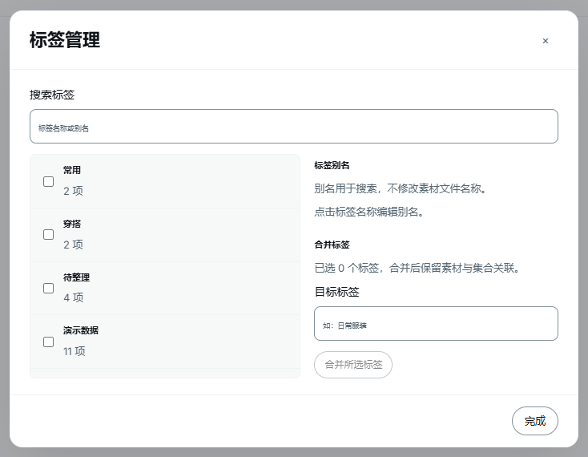

### 27　建立手工集合

**用途：**把“春季搭配”“直播准备”等需要放在一起看的素材组成清单。同一素材可加入多个集合。

**准备：**集合只记录关联。原素材继续放在 `D:\VRChat素材`，不会生成一份复制品。

**逐步点击：**

1. 在侧栏“集合与智能视图”右侧点“＋”。
2. 在“新建手工集合”填写“集合名称”，点“保存”。
3. 返回素材库勾选需要的素材，点击“加入集合”。
4. 在“加入手工集合”中勾选一个或多个集合，点“保存”。
5. 点击侧栏的集合名称查看结果。要只从该集合拿掉条目，选中后点“从集合移除”。

**成功看到什么：**集合中出现选中素材，其他页面仍能找到原条目。集合旁“⋯”可重命名，“×”可移除集合。

**错误处理：**提示同名集合时换一个名字。移除集合只移除集合与其关联，保留素材和人工标注；误操作可用“撤销整理”。不要用回收站删除来代替“从集合移除”。

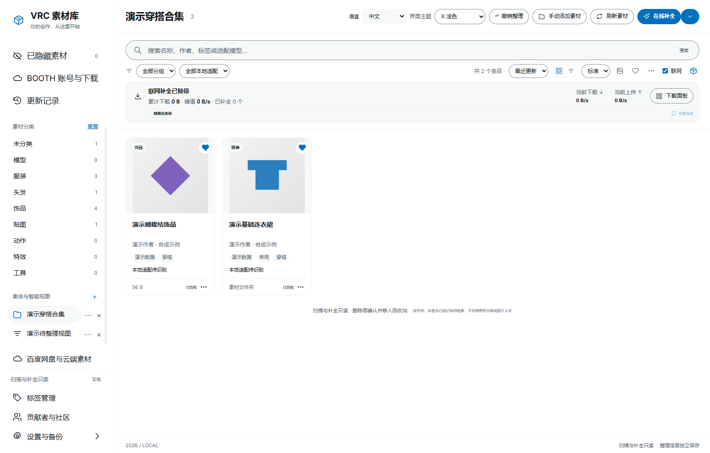

### 28　保存会自动变化的智能视图

**用途：**保存“某角色的服装”“还没加标签的素材”等条件，以后不用重复筛选。

**准备：**先选一个范围，例如左侧“全部素材”。智能视图保存的是条件，并非当下的一张静态清单。

**逐步点击：**

1. 设置搜索词、分类、角色分组或“本地适配模型”。
2. 点击“更多筛选”，按需设置标签、作者、状态、封面、收录日期，或勾选“只看未添加标签的素材”。
3. 核对当前结果，点击工具栏中提示为“保存筛选为智能视图”的按钮。
4. 填写名称，例如“待补标签的服装”，点“保存”。
5. 以后直接点侧栏中这个带筛选图标的视图。

**成功看到什么：**符合条件的新素材会自动出现；修改后不再符合条件的条目会离开该视图，但原素材没有消失。

**错误处理：**结果为空时，先检查条件是否过多、日期是否选错。需要改一套条件时，重新筛选并保存新的智能视图，再移除不用的旧视图；“重命名”只改名字。

### 29　选对撤销按钮

**用途：**分别处理“标注改错”和“商品来源认错”。

**准备：**先判断刚才改变的是整理信息，还是商品对应关系。这两个历史相互独立，各保留最近最多 50 次；不是文件备份。

**逐步点击：**

1. 标签、分类、收藏、集合或标签别名改错，在主界面顶部点击“撤销整理”。它撤销最近一次可撤销的整理。
2. 商品确认错了，在顶部或匹配确认页找到“撤回来源”。先看按钮对应的素材名称，再点击。
3. 回到该素材，检查原来源、候选和自己的标注。

**成功看到什么：**“撤回来源”恢复确认前的商品资料、封面和候选，保留人工标题、分类、标签、备注、收藏等其他标注。原固定确认批次的素材可回到原位置。

**错误处理：**按钮提示记录失效时，查看当前最新记录，不要连续点旧按钮。恢复资料库备份会清除此前的来源撤回历史。已经回收的原文件要去 Windows 回收站还原；Unity 场景中的装配要用 Unity Undo，均不由这里恢复。

## 第六部分 · 读取工程文件与商品

### 30　查看工程关联，并手动补充素材

**用途：**把一个角色工程和用过的衣装、模型、贴图联系起来，方便以后查找。

**准备：**工程应先出现在“工程与成品”。没有时可点“添加工程”，选择包含 Assets、Packages、ProjectSettings 的 Unity 工程文件夹，不要只选 Assets。

**逐步点击：**

1. 在“工程与成品”点击目标工程，打开详情。
2. 找到“工程内素材”，查看“手动关联”“工程文件线索”或“待核对”等标记。
3. 新导入文件或改过文件名后，点“刷新工程素材”。
4. 要补充关系，点“手动关联素材”，搜索条目并勾选，点击“保存”。也可在详情下方“关联素材”使用“管理关联”。
5. 点关联素材卡片查看详情，再用“‹ 返回工程：…”回到工程。

**成功看到什么：**工程中出现关联素材和已有封面；“工程文件线索”可展开查看对应名称与路径。

**错误处理：**找不到条目时缩小搜索词，每次最多显示 80 项。名称相同不一定是同一商品；只有手动关联但没有文件依据时，不能据此声称已经导入，更不能证明当前角色正在使用。

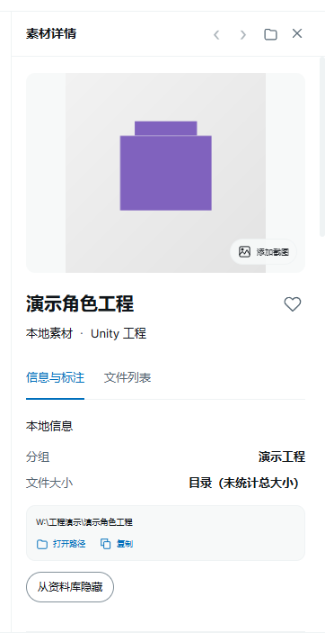

### 31　逐层浏览工程 Assets 和依赖

**用途：**即使文件没有匹配到商品，也能查看它在工程里的真实位置。

**准备：**核对工程详情的完整路径，避免打开同名旧工程。

**逐步点击：**

1. 在工程详情点击“查看工程文件”。
2. 在“工程素材文件”窗口的 Assets 页点击文件夹名进入，用上方面包屑返回。
3. 输入“筛选当前列表”查找当前已载入的文件；有更多内容时点“加载更多工程文件”。
4. 对目标行点“定位”或“复制路径”；右键也能打开所在文件夹。
5. 切换“工程依赖”，查看工程声明的包名、版本和 Unity 版本。改过工程内容后点“刷新工程文件”。

**成功看到什么：**看到 Assets 中实际存在的目录、Prefab、模型、贴图等文件，而不是只看到素材库已认识的商品。

**错误处理：**筛选不搜索整个工程，只筛当前载入列表；应先进入正确目录。未读到依赖信息时检查工程是否完整，不要删 Packages 试图修复。显示上限或读取警告时，当前结果不能代表整个工程。

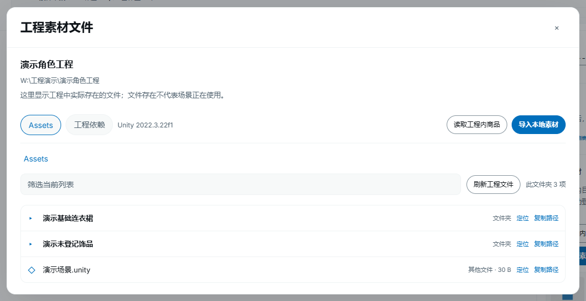

### 32　从已有工程登记商品线索

**用途：**以前直接在 Unity 导入过素材，原下载包不在素材库时，补建商品资料。

**准备：**这是读取线索，不是购买记录核验，也不是场景引用分析。

**逐步点击：**

1. 在工程详情、右键菜单或工程文件窗口点击“读取工程内商品”。
2. 在“工程内商品”查看结果，展开“查看识别依据”，用“定位”核对 Assets 路径。
3. 用“搜索工程商品”和“筛选工程商品”缩小范围。
4. 单项点击“登记并匹配”；关闭联网时按钮为“登记到素材库”。多项可勾选后点“登记选中项（…）”，每批最多 100 项。
5. 对模糊结果展开“BOOTH 搜索与手动来源”，使用“内置 BOOTH 搜索”或填写商品网址／BOOTH ID 后点“读取手动来源”。

**成功看到什么：**出现登记提示；条目进入素材库，分组显示“工程内商品 · 工程名”。开启联网时进入原有补全队列。

**错误处理：**“库内或名称线索”“待核对多个来源”需要人工核对。说明文件里的参考链接不一定是本商品。导入新内容后点“刷新读取”；若提示未覆盖全部内容，请保留这个限制，不把空结果解释为工程没有素材。

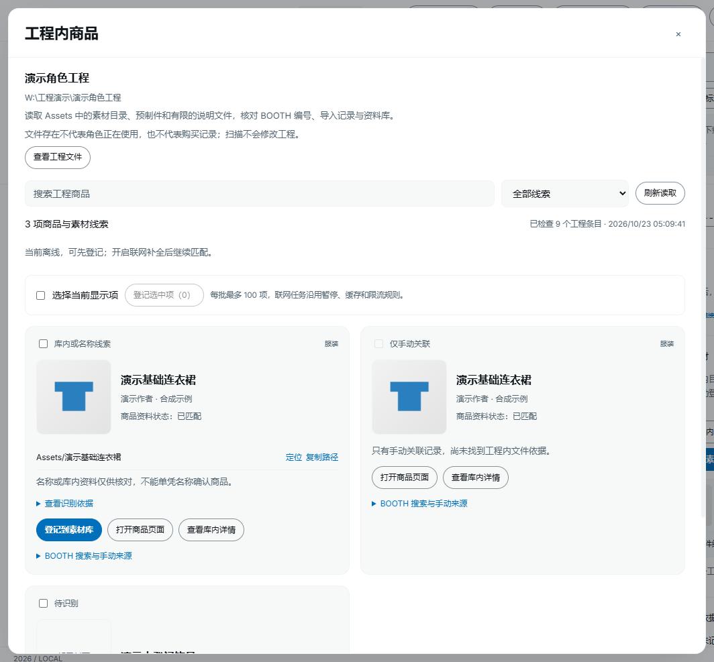

## 第七部分 · 工程导入与可选 MA 装配

### 33　选清源文件、适配包与目标工程

**用途：**把已经拥有的本地素材导入指定 Unity 工程。

**准备：**先给目标工程做自己的工程备份，按作者说明准备相容的 Unity、VRChat SDK、着色器等依赖。资料库备份不能代替工程备份。ZIP、RAR、7z 需要自己先解压，再刷新素材或添加解压目录。不要把扫描登记当作已经导入。

**逐步点击：**

1. 素材卡片右键选“导入到工程”，或在素材详情点同名按钮。也可在工程详情点“导入本地素材”。
2. 检查左侧“本地素材”。需要更换时点“更换素材”。
3. 在“选择要导入的文件或适配包”选具体文件。例如同一衣装有多种角色版本时，按作者说明选择自己的版本。
4. 在“选择目标工程”明确选择工程；没有列出时点“选择其他工程文件夹”。
5. 等待“导入预览”，核对源路径、目标路径、Unity 版本、文件数、大小和所有提示。改变选择后重新核对。

**成功看到什么：**预览准备完成，“导入到所选工程”可以点击。到这一步仍可取消；最终点击才主动写入工程。

**错误处理：**按钮不可用时先看红色错误和提示。多个包不替你判断适配版本。已有等待任务应先完成或取消。路径重叠、链接、文件变化或无法完整检查依赖时，不要绕过保护，应调整源目录或按作者说明改用 Unity 素材包方式。

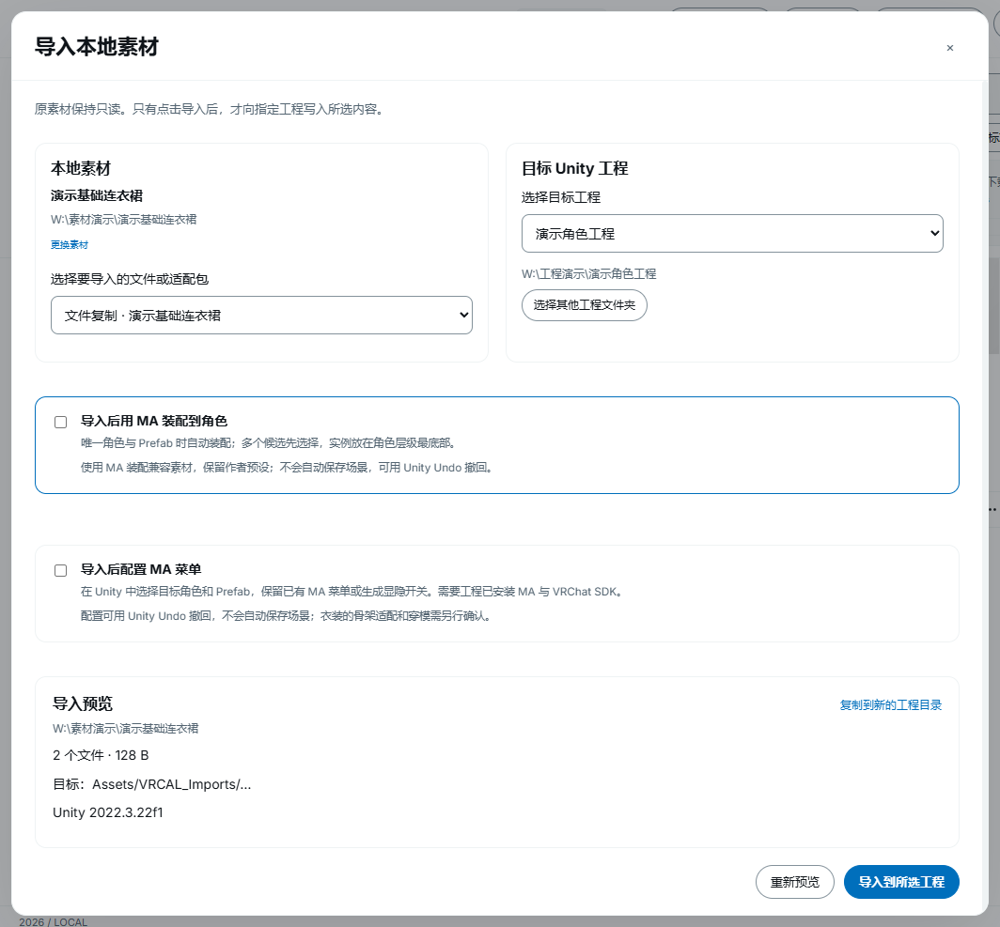

### 34　导入 .unitypackage 素材包

**用途：**通过 Unity 原生导入窗口，确认素材包的具体内容。

**准备：**完成上一个任务的预览。`.unitypackage` 是 Unity 素材包，不是普通 ZIP。程序首次主动导入会向这个工程安装自己的开源 Editor 助手，Unity 会正常编译它。

**逐步点击：**

1. 确认预览显示“由 Unity 原生导入”。
2. 如未找到完全相同版本的编辑器，点“选择 Unity 编辑器”指定正确的 `Unity.exe`，或自己用正确版本打开工程。
3. 点击“导入到所选工程”。
4. 看到“等待 Unity 确认”后切换到目标 Unity；必要时点记录中的“启动 Unity 工程”。
5. 等待 Unity 编译，在 Unity 原生导入窗口核对条目。确认名称、路径及已有内容，再决定导入或取消。

**成功看到什么：**管理器的“工程导入记录”从“等待 Unity 确认”到“Unity 正在处理”，最后显示“导入完成”。源素材包保持原样。

**错误处理：**原生窗口可能涉及已有资源覆盖，管理器不会替你选择覆盖项。“等待”不是成功；编译报错、未刷新或助手未加载时，先在 Unity 处理。请求尚未接收可点“取消等待”；Unity 已接收后应在 Unity 窗口取消。不要因等待而连续重复导入。

### 35　复制普通文件或文件夹

**用途：**把可直接使用的普通资源复制进工程，而不是把下载压缩包塞进 Assets。

**准备：**在具体文件选择中确认显示“文件复制”。普通复制会保留原目录结构与 `.meta`；`.meta` 是 Unity 保存资源身份和导入设置的配套文件。

**逐步点击：**

1. 核对预览显示“复制到新的工程目录”，目标为 `Assets/VRCAL_Imports/…`。
2. 阅读 GUID 检查结果。GUID 可理解为 Unity 用来识别资源的编号，不是商品编号。
3. 无冲突且准备完成后，点“导入到所选工程”。
4. 查看“正在复制”的文件数和字节进度。
5. 完成后到 Unity 等待资源导入和编译，并按作者说明检查依赖。

**成功看到什么：**记录显示“导入完成”，文件位于新的 `Assets/VRCAL_Imports` 子目录，原有工程文件不会被这次普通复制覆盖。

**错误处理：**“工程已有相同 GUID”表示程序停止，不能简单删除 `.meta` 来强行通过。先检查是否已经导入过、是否选了重复目录。复制时源文件变化则重新预览。“文件已复制完成，素材关联稍后重试；请勿重复导入”表示文件已经落入工程，应先核对记录与工程位置。

### 36　看导入记录，找到真正的 Assets 位置

**用途：**区分“计划放哪”“实际导入哪”，避免回原下载目录寻找工程文件。

**准备：**打开目标工程的“查看工程文件”或“导入本地素材”，向下找到“工程导入记录”。

**逐步点击：**

1. 按素材名、时间和状态找到本次记录。
2. 只有文件导入完成后，查看“导入后的 Assets 位置”。
3. 点“定位导入位置”，或点“复制 Assets 路径”。需要时展开“查看 … 个已记录文件”。
4. 旧记录缺少准确位置时，可使用出现的“查找新增／修改位置”，再查看“工程变化候选位置”。
5. MA 任务另看“用于装配的 Prefab”和“角色层级位置”。

**成功看到什么：**普通复制显示本次新目录；Unity 素材包显示 Unity 返回的实际路径，可能分散在几个文件夹，不一定以包名命名。

**错误处理：**显示“Unity 尚未返回本次导入的位置”就应去工程核对。部分路径清单不代表其余未导入。“工程变化候选位置”可能包含同期人工编辑，只是定位线索，不能当作准确导入清单。文件导入与 MA 装配状态分开看。

### 37　用 MA 把预制件装配到角色

**用途：**把兼容素材的预制件实例放入目标角色，并使用 Modular Avatar 处理相应绑定。

**准备：**MA 是 Modular Avatar 插件。目标工程需要已安装兼容的 MA 与 VRChat SDK，Unity 编译正常，已打开包含角色的场景。先保存自己的场景基线，并明确衣装支持哪个角色。该选项默认关闭。

**逐步点击：**

1. 在管理器导入窗口勾选“导入后用 MA 装配到角色”，重新核对预览，再执行导入。
2. 等文件真正导入。只有一个有效场景角色、一个完整明确的本批预制件时，可能自动装配；因此点击导入前就要核对当前场景。
3. 多个候选时切到 Unity 的“VRCAL · MA 装配助手”，选择“导入记录”“已加载的角色”和“本次导入的预制件”。角色要选场景根对象，预制件要选本批 Assets 资源。
4. 阅读提示，点“装配到所选角色最底部 · 支持撤销”。窗口关闭后可从 `Tools → VRC 素材库 → 装配导入的预制件` 再打开。
5. 在 Unity 层级里展开角色。实例应直接位于角色下面，并排在子物体末尾。手工检查骨架、比例、材质、穿模和动作，再自行保存场景。

**成功看到什么：**管理器显示“MA 装配完成”，并列出预制件与角色层级位置。这个模式不额外新建游戏内菜单开关。

**错误处理：**没有角色、没有预制件、缺依赖或绑定无法核实时，先按提示处理，不要把随意改父级当作成功。需要放弃可点“跳过 MA 装配 · 保留已导入文件”。场景装配支持一次 Unity Undo；它不负责移除已导入的资源文件，也不会自动保存场景。此功能不能保证任意衣装跨角色自动适配。

### 38　需要显隐菜单时，选另一种 MA 模式

**用途：**保留作者已有 MA 菜单，或给导入实例配置显示／隐藏开关。

**准备：**同样需要兼容的 MA、VRChat SDK 与有效场景角色。“导入后配置 MA 菜单”和“导入后用 MA 装配到角色”是两种互斥选项。

**逐步点击：**

1. 在导入窗口改选“导入后配置 MA 菜单”，核对预览并导入。
2. 在 Unity 助手选择角色和本批预制件。
3. 有作者预设时核对“保留作者的 MA 预设”；需要自己生成时填写“菜单名称”和“默认显示”。
4. 点击“应用到场景 · 支持撤销”，测试结果后自己保存。

**成功看到什么：**记录显示 MA 菜单配置状态；作者保留模式沿用原菜单名称、默认状态与参数。

**错误处理：**菜单配置不等于衣装骨骼已正确适配。旧助手界面可在完成记录里点“更新 MA 中文界面”，等待 Unity 编译后重开窗口。自定义过的助手不会被直接覆盖。文件已导入而 MA 失败时，只有出现“重试 MA 配置”才按提示重试，无需重导素材。

## 第八部分 · BOOTH 下载与云端目录

### 39　登录 BOOTH，查看喜欢、Gift 和已购商品

**用途：**在应用内进入自己有权访问的 BOOTH 页面，并管理下载记录。

**准备：**开启“联网”。准备自己的 BOOTH／Pixiv 登录方式，验证码和账号验证由自己在官方页面完成。资料库中的“收藏”与 BOOTH“我喜欢的”是两个独立列表。

**逐步点击：**

1. 点左侧“BOOTH 账号与下载”。关闭联网时先点“启用联网”。
2. 点“登录 BOOTH”，在官方页面正常登录。
3. 返回页面，按需点“我喜欢的”“Gift / 礼物”或“已购资料库”。
4. 在“素材下载位置”点“选择下载位置”。选择 C 盘外、素材扫描目录外的独立目录，例如 `D:\BOOTH下载`。
5. 回到有权限下载的商品页面，点击网站提供的下载文件。

**成功看到什么：**管理器“下载记录”出现文件名、进度、速度和已接收字节。完成后点“打开文件位置”或“查看已导入素材”。这里的“导入素材”表示登记进素材库，不是导入 Unity。

**错误处理：**是否登录以 BOOTH 网页为准，“会话已保存”不保证服务器仍认定登录。下载完成但登记失败时点“重试导入”；下载中断则回网站重新点击，不把它理解为断点续传。任务保存在独立子目录，不覆盖旧文件，不自动解压、执行或导入 Unity。要退出，点“退出并清除会话”，下载文件和标注仍保留。

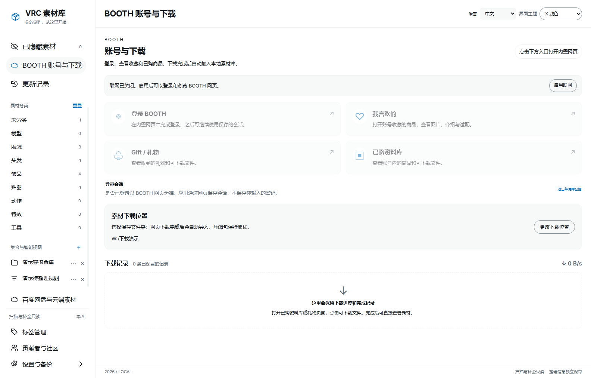

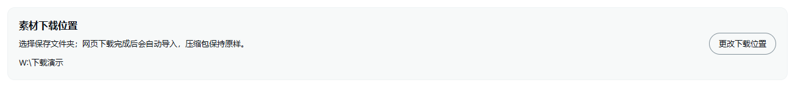

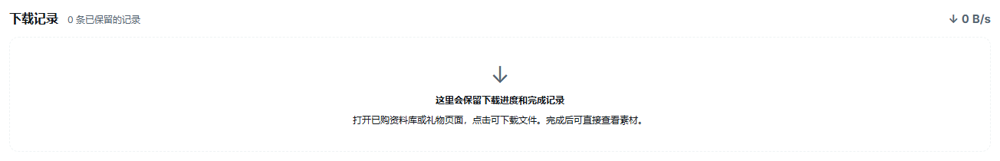

### 40　读取百度网盘母目录和全部子目录

**用途：**把网盘里“存了哪些包”的目录信息记下来，与本地素材对照；不是下载工具。

**准备：**开启联网。此功能标为“网页接入试验”，不需要申请 AppKey。准备在独立官方网页中自己登录百度账号。

**逐步点击：**

1. 进入“百度网盘与云端素材”，点“打开百度网页登录”。
2. 登录后，在网页打开要整理的母文件夹。例如只想整理衣装，就进入衣装文件夹，不停在不相关的网盘位置。
3. 点“读取此文件夹及所有子文件夹”，核对进度中的“读取范围”和“当前目录”。
4. 程序会逐层切换网页目录。要自己浏览前，先在管理器点“暂停读取”；处理后点“继续读取”。不再读取时点“停止读取”。
5. 有失败目录时展开“有 … 个目录待重试”，处理登录或网络问题后点“重试失败目录”。

**成功看到什么：**进度列出已读目录、文件和待处理数量；下方出现云端记录。重启后保留为暂停状态，点“继续读取”再接着读。

**错误处理：**遇到验证、分页、网页改版或目录过大可能停止。先处理网页问题，再继续；换账号后不能接着读旧账号任务。普通“读取当前文件夹”只记录当前可见部分，不代表读完全部子目录。已有索引保留，未读到的文件不会因此判定缺失。单目录最多 5,000 条，合计最多 2,000 个目录／50,000 条；到达上限时不要把结束提示理解为完整网盘清单。

### 41　看懂“云端与本地”，修正关联

**用途：**寻找同一商品的云端和本地存放线索，减少重复寻找。

**准备：**先有云端索引，并把本地素材登记到资料库。以下标记都不证明版本、适配和文件内容完全相同。

**逐步点击：**

1. 在“存放位置”选择“云端与本地”“仅云端记录”或“关联待确认”。
2. 查看文件名、路径、“上次看到”和关联依据。
3. 对需要人工处理的条目点“关联本地素材”，搜索并点击正确的本地条目。
4. 明确不是同一个时点“保持独立”；要撤销人工决定，点“恢复自动关联”。
5. 已关联时点“查看本地素材”继续核对。

**成功看到什么：**“云端与本地”表示有可用本地对应物；“仅云端记录”表示尚无对应物；“关联待确认”表示存在多个候选。自动对应可能依据唯一商品编号，或唯一的文件名与正数大小。

**错误处理：**旧索引可能过期，应重新读取。只想清掉本地目录记录时，展开“已读取的目录”，点“移除索引”并确认；不会删除网盘文件。离线可看保存的索引，不能借此打开网盘新内容。关联不会下载、复制或同步文件。

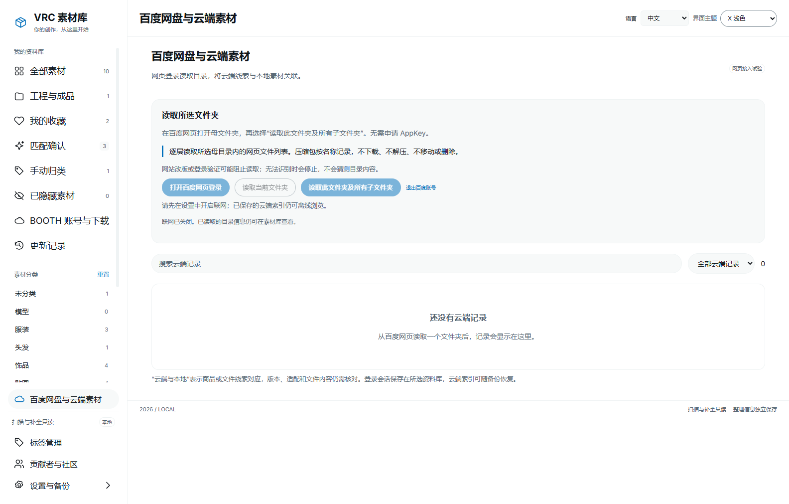

### 42　按需启用闲鱼辅助搜索

**用途：**用网页名称或图片线索辅助查找素材出处，仅用于搜索，不可用于购买。

**准备：**开启联网；此功能默认关闭。先阅读提醒，闲鱼结果不能证明原作者、正版权利或授权，也不替代 BOOTH 购买记录。

**逐步点击：**

1. 在“设置与备份 → 辅助搜索”勾选“启用闲鱼搜索”，阅读并确认提示。
2. 回“匹配确认”，点目标素材的“进行闲鱼尝试补全”。
3. 在独立官方网页核对关键词，必要时自己登录。进入真正的商品详情页。
4. 页面有效且有资料时，使用工具栏“应用此商品”。网页未能读取名称时，按提示填写“商品名称（网页未能读取时手动填写）”后再核对应用。
5. 来源不对时用“撤回来源”；不需要时回设置关闭。

**成功看到什么：**读取到的公开商品资料进入当前素材；关闭功能后入口隐藏，辅助窗口关闭。

**错误处理：**搜索页、登录页、验证页或尚未加载完成的页面不能当作商品。标题、作者或图片不可验证时不作完整资料承诺。网站限制或仅客户端可见内容可能导致失败；不会绕过验证。图片另存后到其他应用手动搜索，是自己的独立操作，不是程序自动上传。

## 第九部分 · 设置、备份与更新

### 43　调语言、主题、缩放与右键菜单

**用途：**让界面更适合自己的屏幕与习惯。

**准备：**语言改变按钮文字，不翻译素材名、人工标签、备注或 BOOTH 网页正文。

**逐步点击：**

1. 在主界面语言选择框或“设置与备份”选择“简体中文”“日本語”“English”。
2. 用“界面主题”选择“X 暗色”“X 浅色”“NASA 朋克”或“瑞士国际主义”。设置中也有主题预览。
3. 按住 Ctrl 滚动鼠标滚轮调整整界面大小。过大时进“显示大小”，点“重置为 100%”。“内容密度”只调整内容疏密，与缩放不同。
4. 在“设置与备份 → 右键菜单”勾选想显示的项目，用“上移”“下移”排序，或点“恢复默认”。

**成功看到什么：**设置立即生效并保存。右键菜单仍只显示当前条目可用的操作，末尾保留“设置右键菜单”。

**错误处理：**菜单少了选项，先查是否被隐藏、当前条目是否适用。出现“尚未保存”时点“重试保存”。小屏上匹配确认顶部挤占空间，可用右上小锁“解锁顶部区域”；需要常看筛选时再“锁定顶部区域”。

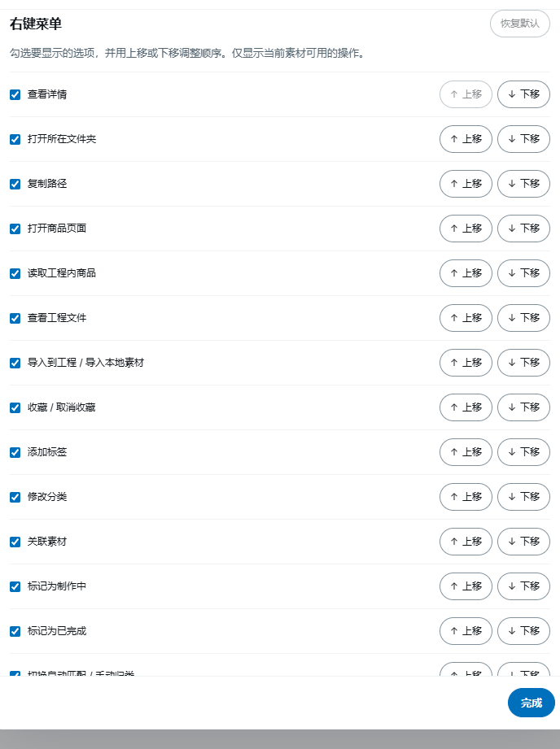

### 44　停止显示某个素材路径

**用途：**停止扫描旧素材盘或旧文件夹，同时保留整理资料。

**准备：**确认这是停止登记范围，不是要把文件移入回收站。扫描进行中先停止扫描。

**逐步点击：**

1. 进入“设置与备份 → 素材位置”。
2. 核对完整路径，在要停用的那一行点“移除”。“手动添加”标记说明该路径来自手动选择。
3. 需要恢复范围时点“添加素材文件夹”，选回原文件夹；独立素材也可重新拖入原路径。

**成功看到什么：**该路径退出当前扫描与图库范围；原文件、封面和人工标注保留。重新添加原路径后可继续沿用标注。

**错误处理：**母目录包含资料库或备份时会要求先迁移，不能只靠给文件夹改名解决。扫描根是要读的范围；资料库是整理数据的保存位置，两者应分开。

### 45　把资料库迁移到新位置

**用途：**更换整理数据的保存位置，不必搬动原素材。迁移会保留旧库，本身不会释放旧库占用的空间。

**准备：**准备 C 盘外、素材目录外的新空位置，保证空间足够。先结束工程导入、下载和其他操作。不要边迁移边拔掉磁盘。

**逐步点击：**

1. 进入“设置与备份 → 资料库数据”，记录当前显示的完整路径。
2. 点击“更改保存位置”。
3. 选择与当前位置不同的新上级目录，例如 `D:\VRCAL资料库-新位置`。程序使用其下的 `VRChatAssetLibrary`；目标已有其他内容时请换空位置。
4. 等待复制和核对完成，按应用流程重启。
5. 重启后回“资料库数据”检查新路径，再抽查几条收藏、标签、封面和下载记录。

**成功看到什么：**资料库从新位置加载，原资料库仍保留；原素材继续引用原路径。浏览会话会随迁移处理，但网站仍可能要求重新登录。

**错误处理：**磁盘未连接、空间不足或权限错误时先处理提示，不要删除旧库。启动显示“找不到已登记资料库”时，应重新连接磁盘或选择原资料库本身／上级目录，核对其中已有数据；不要为了进入界面而另建空库冒充原库。

### 46　导出整理备份，再按需合并恢复

**用途：**保存分类、备注、封面、集合等整理信息。原素材、Unity 工程、下载原文件和登录凭证要另外管理。

**准备：**准备 `F:\VRCAL备份` 等 C 盘外、素材目录外的位置。最好与资料库分盘，避免同一块盘损坏时一起丢失。

**逐步点击：**

1. 进入“设置与备份 → 备份与恢复”，点“选择备份位置”，选择 `F:\VRCAL备份`。
2. 点“导出备份”，在保存窗口核对文件名并保存。
3. 看到“备份已保存”后，在资源管理器确认文件存在。不要手工修改备份正文。
4. 需要恢复时先停止扫描，点“恢复备份（合并）”，选择自己的备份文件。
5. 阅读“合并恢复备份中的分类、备注和封面？”确认框，决定恢复或取消。恢复前应用会先备份当前资料库。

**成功看到什么：**提示“资料库已恢复”；备份里对应记录被更新，现有其他记录保留。抽查标注、集合、封面和素材路径。

**错误处理：**校验失败或文件无效时保留原文件，换一份可靠备份，不要删校验内容强行导入。恢复不会重建被删的素材或工程，不会帮你重新下载 BOOTH 文件，也不恢复网页登录凭证。原素材盘不在时先接回原盘。备份恢复后，来源撤回与整理撤销历史都会清空，不能用“撤销整理”撤回整次恢复。

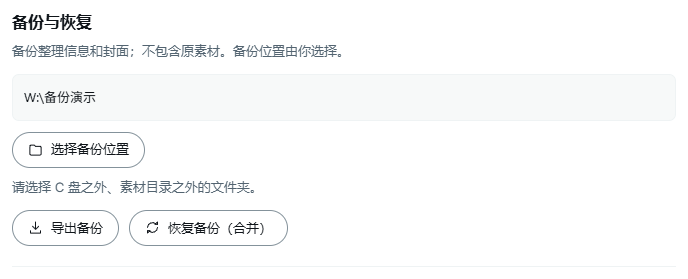

### 47　查看版本记录并使用内置更新

**用途：**了解本次改变了什么，再决定是否更新程序。

**准备：**内置安装适用于官方 Windows x64 免安装版。更新程序和恢复资料库备份是两件事。

**逐步点击：**

1. 点左侧“更新记录”，按版本或功能词搜索，查看当前运行版本；这个页面断网也能看。
2. 打开“设置与备份 → 应用更新”，点“检查更新”。
3. 有新版时阅读“更新说明”，点“下载更新”，观察持续显示的进度与已下载量。
4. 显示“更新已下载”后，先停止扫描、联网补全和下载，并完成工程导入。
5. 点“重启并更新”，阅读确认框后确认。重启后检查当前版本。

**成功看到什么：**程序经过下载校验后切换新版，资料库和原素材继续使用。

**错误处理：**下载中可“取消下载”；断网、校验失败或不支持自动安装时，旧程序仍可用。点“打开发布页面”手动获取官方新版，不要改资料库来修更新。程序放在受保护素材目录、文件变化或路径有链接时可能拒绝自动安装。旧测试版编号与正式版不连续时，按发布说明手动运行新版一次并沿用原资料库。

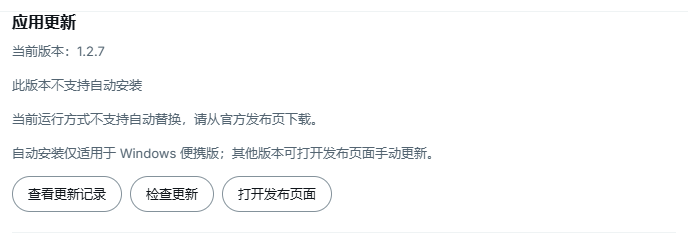

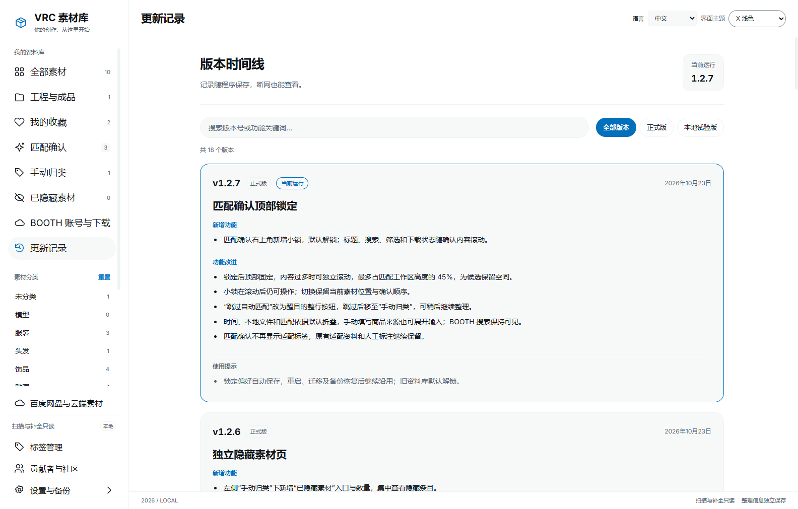

## 第十部分 · 排查问题与社区求助

### 48　素材不见了、页面为空或原文件找不到

**用途：**先判断是筛选、显示状态、路径停用还是磁盘文件问题。

**准备：**记住一个确定存在的素材名或原路径，不急着重新下载或清空资料库。

**逐步点击：**

1. 回“全部素材”，清空搜索，解除分类和“更多筛选”，退出收藏或自建集合范围。
2. 到“已隐藏素材”搜索，找到后点“恢复显示”。被跳过的素材另查“手动归类”。
3. 在“设置与备份 → 素材位置”检查原路径是否仍登记、磁盘盘符是否正确。
4. 用资源管理器检查文件。若曾回收，请在 Windows 回收站还原到原路径，再“刷新素材”或重新拖入原位置。

**成功看到什么：**条目重新出现，原标注继续保留；原先隐藏的回收文件还原后仍按隐藏状态管理。

**错误处理：**看到“原文件暂时无法找到”并不表示标注被删。文件已真正丢失时，整理备份不能还原文件，应找自己的素材／工程备份。读取错误可用页面“重新读取资料库”，并查看“设置与备份”中的读取提示。

### 49　联网、工程导入或云端读取卡住

**用途：**按卡住的功能处理，避免把不同任务混为一谈。

**准备：**记录界面原文与时间。网络面板的速率统计是本应用观察到的响应正文，不代表整台电脑的全部流量。

**逐步点击：**

1. 商品补全不动：检查“联网”和队列是否暂停，再看网络面板的失败、限流和重试提示。已有人工来源不要随意清除；只对需要的素材“重新匹配”。
2. BOOTH 下载不动：查“下载记录”是中断、取消还是失败，回商品网页重新点击；只有文件保存后登记失败才用“重试导入”。
3. 工程显示“等待 Unity 确认”：切到正确工程，检查 Unity 原生窗口、编译错误和助手加载状态；不要重复提交。
4. 文件“导入完成”而 MA 未完成：检查角色、预制件、MA／SDK 与绑定，单独处理 MA 提示。
5. 网盘目录中断：先暂停，处理登录验证和网页位置，再“继续读取”或“重试失败目录”。

**成功看到什么：**对应任务有明确状态变化，而不是单纯关闭错误提示。失败时已有商品资料、标注或已读目录应继续保留。

**错误处理：**网站拒绝访问、验证或暂时超时，不足以证明系统代理故障。应用读取系统代理，不代你修改它。未知错误请保留原文、路径和任务状态，再按下一节反馈；不要删 `.meta`、工程依赖或唯一资料库来试错。

### 50　联系社区或反馈问题

**用途：**让别人能复现问题，减少来回询问，也可交流素材整理与改模。

**准备：**先准备当前版本、Windows 版本、刚才的操作步骤、错误原文、出现时间、预期结果和实际结果。界面布局问题补充语言、主题、缩放比例与窗口大小。

**逐步点击：**

1. 点左侧“贡献者与社区”。
2. 点“反馈问题”，在系统浏览器打开的问题页面描述情况；源码和参与方式可从同页查看。
3. 想加入 QQ 群，点“加群聊天”，扫描显示的二维码，或点“复制群号”：**1002563035**。
4. 提供能看清按钮和状态的截图。导入问题注明源类型、目标 Unity 版本、是否启用 MA，以及文件导入和 MA 的各自状态；网盘问题注明当前目录和暂停／失败状态。

**成功看到什么：**对方能按步骤理解在哪一步失败，判断问题属于读取、下载、导入还是资料库保存。

**错误处理：**发截图前遮住账号、私人目录和敏感内容。不要发送密码、Cookie、签名下载链接、完整会话文件或未经允许的付费素材。必要时用不含私人内容的小样例说明；不要把“不见了”直接当作已经查明的数据删除原因。

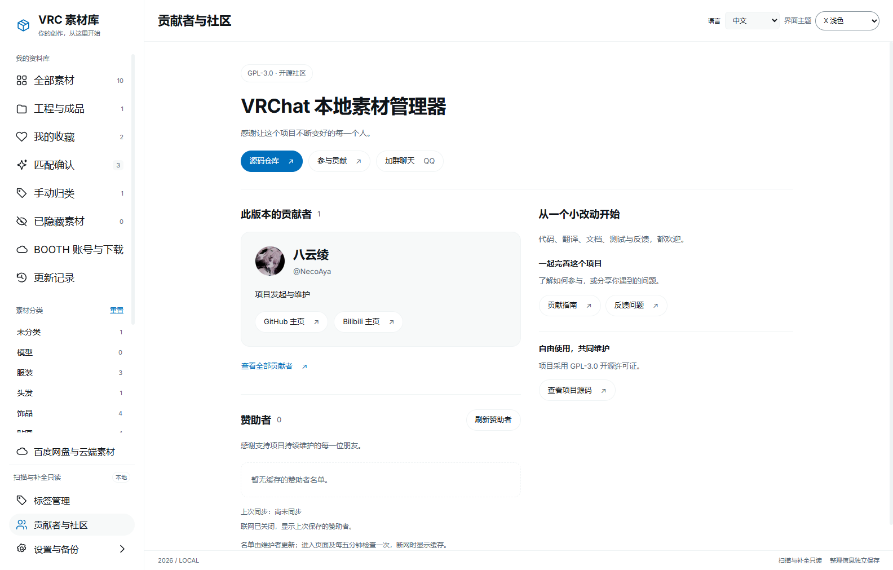

## 常用词小字典

| 看到的词 | 可以这样理解 |
| --- | --- |
| 素材 | 自己保存的衣装、头发、模型、贴图、工具等文件或包 |
| 条目／卡片 | 资料库中的一条登记；一张卡片可能包含多个本地文件 |
| 母目录／子目录 | 外层文件夹／放在它里面的文件夹；目录就是文件夹 |
| 路径 | 文件在电脑上的完整地址；改盘符、改父文件夹都会改变它 |
| 封面 | 帮你认出素材的图片；有封面不代表文件已导入工程 |
| 分类 | 服装、头发、饰品等大类别；鞋袜归服装 |
| 标签／备注 | 自己加的短关键词／较长说明，便于搜索与记事 |
| 商品来源／BOOTH ID | 对应的公开商品页面／该商品编号；不是订单号或 Unity GUID |
| 待确认 | 程序还不能可靠判断，需要你核对，不等于已选中正确商品 |
| 适配 | 为某个角色模型准备的版本；名称线索不是实际试穿结果 |
| 缓存 | 应用保存的网页资料或图片副本，方便下次读取 |
| 资料库／SQLite | 整理数据的保存处／其中的数据库文件，不是素材包 |
| Unity 工程／Assets | 用 Unity 打开的工作项目／工程里放资源的文件夹 |
| Prefab／预制件 | Unity 中可以放入场景、创建实例的资源模板 |
| .meta／GUID | Unity 资源身份与设置的配套文件／资源编号；不要随意删除 |
| MA／SDK | Modular Avatar 装配插件／VRChat 开发工具依赖；不是应用自动保证已安装 |
| 关联／导入 | 在资料库记住关系／实际把资源写入工程，是两件事 |
| 隐藏／回收 | 只让应用收起条目／把真实原文件移入系统回收站 |
| 迁移／备份恢复 | 换整理数据的保存位置／合并导入以前保存的整理信息 |
| 云端索引 | 网盘目录的历史记录；不是同步、下载或内容完整性证明 |

## 操作前后核对清单

### 每次开始整理

1. 检查当前资料库路径与原素材所在磁盘。
2. 确认当前页面、搜索词和筛选条件。
3. 批量操作先检查已选数量，合并卡片还要看成员路径。

### 每次确认商品

1. 核对本地文件名、商品名称、作者和页面说明。
2. 预览网页后再确认；候选封面单击会采用，不是单纯放大。
3. 选错时使用“撤回来源”，不需要删除素材。

### 每次导入 Unity

1. 备份目标工程，核对源包、适配版本、目标工程和依赖。
2. 阅读预览，再主动提交；Unity 原生窗口还需要自己核对。
3. 把文件导入、MA 装配、编译和试穿分别检查；最后自己保存场景。

### 每次删除

1. 只是暂时不想看，先选择隐藏。
2. 确实要回收，逐条核对确认窗口的真实路径和文件夹范围。
3. 检查逐项结果。误回收去 Windows 回收站还原到原路径，再刷新。

### 整理结束

1. 抽查刚改过的几条资料，清除不再使用的多选。
2. 导出一份整理备份，同时保管好另外的原素材与工程备份。
3. 正常关闭应用，不在任务仍运行时拔掉磁盘。

## 这本手册的范围与截图说明

手册对应 1.2.7 Windows x64，编写日期为 2026 年 10 月 23 日。步骤以发布源码和实际运行界面为依据；网站登录、验证、页面排版及服务器状态可能变化。离线网页版可点击目录和图片查看大图；PDF 可搜索文字、使用书签，并放大截图。

截图由最终打包程序实际运行生成，未重绘界面，也未用截图拼造功能成功。演示文件仅用于展示目录、标签、候选和导入预览，不能用于改模。源码与演示文件的只读核对记录随本说明书提供。没有为拍摄执行真实下载、真实 Unity 导入、MA 场景装配或删除原素材。相关功能的“成功后看到什么”说明用于你操作后核对，不能代替你自己的结果检查。

应用源码、正式发布与反馈入口：[GitHub 项目](https://github.com/NecoAya/VRCAL-VRChat-Asset-Library)、[正式发布](https://github.com/NecoAya/VRCAL-VRChat-Asset-Library/releases)、[提交反馈](https://github.com/NecoAya/VRCAL-VRChat-Asset-Library/issues/new/choose)。社区 QQ 群：1002563035。
