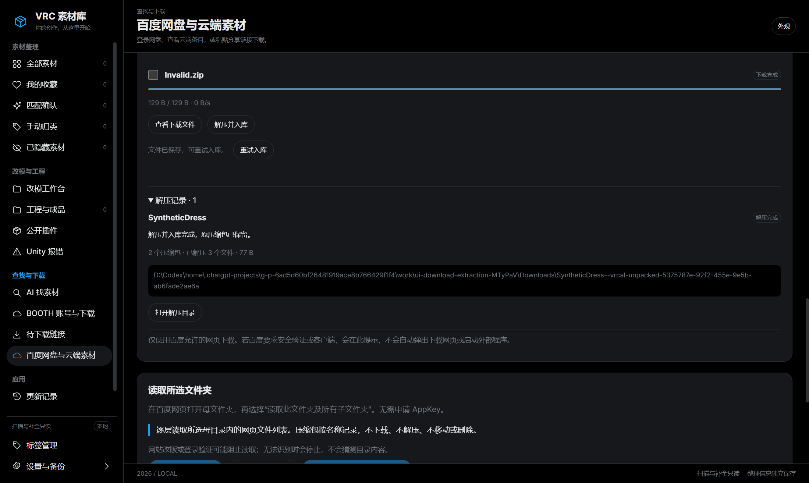
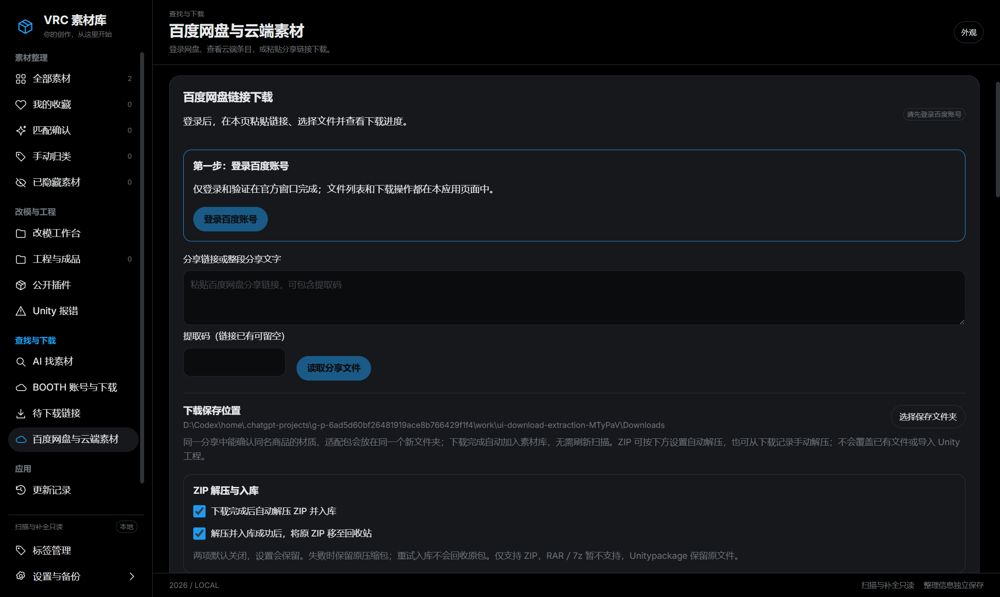

# 下载、勾选与自动入库：一步一步操作

适用版本：1.4.0-preview.16。现有下载选择截图保留 preview.14 界面，文件名来自隔离测试资料库，没有用户购买记录或真实付费素材；新增解压功能按下方文字操作。

## 先打开新版本

退出旧的素材管理器，再运行本版。打开“更新记录”确认当前版本；仅下载了新文件但仍在使用旧窗口，旧窗口的行为不会改变。继续使用原资料库，不要删除库或重新确认全部素材。

## 百度链接：登录、读列表、勾选、下载

1. 点击左侧“百度网盘与云端素材”，或者“待下载链接”下方的百度下载区域。
2. 没登录时点击“登录百度账号”。只在百度官方登录窗口输入密码和验证码；登录后回到应用页面。
3. 把分享链接或整段分享文字粘贴到“分享链接或整段分享文字”。链接已有提取码时，下面的提取码框可以留空。
4. 点击“读取分享文件”，等待出现文件列表。文件夹显示“打开文件夹”；先打开它，才能选择里面的文件。
5. 点击文件名前的小方框勾选。勾选不是已经下载；“已勾选 N 个”表示你选了几个。也可以点“全选当前文件”，最多选 100 个。
6. 点击“下载所选（N）”。程序逐个请求正常网页下载；未开启自动解压时，完成一个就加入素材库，再处理下一个。开启自动解压后，ZIP 会在本批次下载后按同商品组解压并登记结果。可以离开这个页面查看图库，不需要点“刷新素材”。
7. 只下载一个文件时，仍可直接点它右侧的“下载此文件”。

## 材质包与适配包为什么会在一起

例如 SyntheticDress_Shinano_ver1.02.zip、MAT_TEX_SyntheticDress_ver1.01.zip 和 PSD_mdp_SyntheticDress_ver1.00.zip，程序能识别共同的 SyntheticDress 文件族。来自同一个分享时，保存到同一个新目录。

目录名带有商品线索和一段唯一标识，例如 SyntheticDress--vrcal-编号。这段标识帮助程序区分自己创建的目录和你原有的目录，不需要手动编辑。

BOOTH 下载有明确商品编号时按商品归组；百度按分享与文件名线索归组。不同分享、不同商品、来源冲突或无法可靠判断的名称保持分开。只处理新下载，不整理或移动你已有的素材目录。

如果再次下载同名文件，会另建目录，保持原文件名并避免覆盖。下载归组本身不展开压缩包；百度 ZIP 可按下方方式手动解压，或开启默认关闭的自动解压。BOOTH 下载不受这两项解压设置影响。合并卡片只影响应用的展示，文件列表和成员路径仍保留。

## 历史模型包与材质包：一起解压到一个新目录

1. 打开百度页面的 **下载记录**，找到已完成的模型 ZIP、材质 ZIP 或适配 ZIP。历史 UUID 目录中的原包也可使用，不需要先移动文件。
2. 勾选同一素材的压缩包。每次最多选 100 个，**全选可解压 ZIP** 只会选择当前可操作范围内的包；请先核对它们确实属于同一素材，避免把无关商品混在一起。
3. 默认保留原包。只有希望本次成功后回收原包时，才勾选上方 **解压并入库成功后，将原 ZIP 移至回收站**。
4. 点击 **解压所选并入库**。只处理一个包也可直接点它右侧的 **解压并入库**。
5. 在 **解压记录** 查看解压、入库阶段及结果；完成后直接查看素材库，或点击 **打开解压目录**。

新目录创建在当前 **下载保存位置** 下。每个 ZIP 使用自己的子目录，因此模型包和材质包处于同一素材目录内，同名文件不会相互覆盖。程序只读取这个新目录并立即登记，不全局扫描，也不自动导入 Unity 工程。

历史 UUID 源目录和原文件不搬动；保留原包时，原包的资料库记录、标题、标签等既有标注保持。解压结果单独登记，原包标注不会因这次操作被清空。原包若已移入回收站，下载记录会说明状态并隐藏原文件定位操作，可从解压记录打开结果目录。

## 下载后自动解压：默认关闭

百度页面的 **ZIP 解压与入库** 有两项设置，首次都不勾选，之后会保存你的选择：

| 设置 | 开启后的行为 |
| --- | --- |
| 下载完成后自动解压 ZIP 并入库 | 对之后开始的下载批次生效；按本批次能够确认的同商品组，把成功下载的 ZIP 解压到新素材目录并登记。不会追溯解压全部历史。 |
| 解压并入库成功后，将原 ZIP 移至回收站 | 手动解压或自动解压成功、校验和入库均完成后，才尝试将参与的原 ZIP 移至系统回收站。 |

可以只开自动解压并继续保留原包，也可以保持自动解压关闭，只手动处理选中的历史包。这些设置属于百度下载页，不改变 BOOTH 下载、云端目录索引或普通扫描。

目前只支持 ZIP，不展开 RAR、7z 或 Unitypackage；加密 ZIP 及不支持的 ZIP 压缩方法会提示原因。不会执行包内脚本或程序，也不会递归展开包里的其他压缩包。

## 解压失败、入库失败与回收失败

- 解压或校验失败：原 ZIP 保留，查看记录中的原因。当前失败尝试的未完成输出会清理，不影响其他素材目录。
- 解压完成但入库失败：保留可用结果目录和原 ZIP，在解压记录点击 **重试入库（保留原包）**。即使设置中勾选回收，重试入库也不会回收原包。
- 成功入库但部分原包未能回收：结果继续保留，记录列出已回收文件及失败提示；不要因此重新下载全部素材。
- 本地文件或目录被移走、替换、变成链接，或资料库正在关闭／迁移：停止操作并显示原因。先恢复或核对实际位置，不覆盖已有目录。

本地历史 ZIP 解压、打开结果及重试入库无需登录或联网；下载、解压或入库仍在进行时，需要等待当前操作结束。系统回收站可由 Windows 还原；移入回收站不代表永久删除，也不代表已经释放磁盘空间。重启不会自动重做解压或回收原包。

## 下载完成后看哪里

- “已加入素材库，无需扫描”：文件已登记，点击左侧“全部素材”即可查看。
- “下载完成”但提示自动入库失败：文件已保存，点击“重试入库”。不需要重新下载。
- 没有封面或需要匹配确认：下载入库与确认商品是两件事。百度分享本身不能证明 BOOTH 商品身份，来源不明时继续走原有匹配流程。
- “查看下载文件”：在资源管理器中定位实际文件。

在素材库中，下载记录显示在“BOOTH 下载”或“百度网盘下载”分组。已有搜索、分类或收藏筛选可能隐藏新下载；先清空搜索、选择“全部分类”“全部分组”。

## 暂停、取消与失败

- 暂停：当前下载先停住，后面的文件继续等待。
- 继续下载：在百度允许恢复时继续当前文件。
- 取消下载：取消当前任务和剩余队列；已完成的文件保留。
- 取消后续队列：当前文件继续，尚未开始的文件取消。
- 断网、登录变化、页面列表变化或中断：停止后续队列，避免误下其他文件。完成登录或验证后重新读取、勾选需要的文件。

百度如果要求客户端或安全验证，应用会如实提示；不绕过限制，不自动启动外部下载工具。

## 闲鱼明明有链接，列表却是空的

1. 先确认运行的是本版，打开闲鱼消息窗口，进入含链接的会话。
2. 在“待下载链接”开启识别，点击“检查新链接”。这是检查当前打开会话；后台选项不会代替这次前台检查。
3. 看“闲鱼交付消息”的状态。已识别但无法核对消息日期、或者提取码冲突时，会提示查看“时间／提取码待核对”，并显示数量。
4. 点击“查看待核对链接”或对应标签页，核对链接与提取码，再点“选择文件下载”。之后仍在应用中勾选具体百度文件。

没有可靠日期的消息不会亮“近期新链接”蓝点；几天前的链接也不会当作新消息。当前真实账号全链路仍待验证。可以把分享文字直接粘贴到百度下载页面继续下载，不需要为此全局扫描素材。

## 本版实际界面示例

下面是隔离离线测试中的实际界面，仅含合成文件。第一张展示两包解压到同一素材的结果；第二张的两项开关已由测试手动开启，首次使用默认都不勾选。

