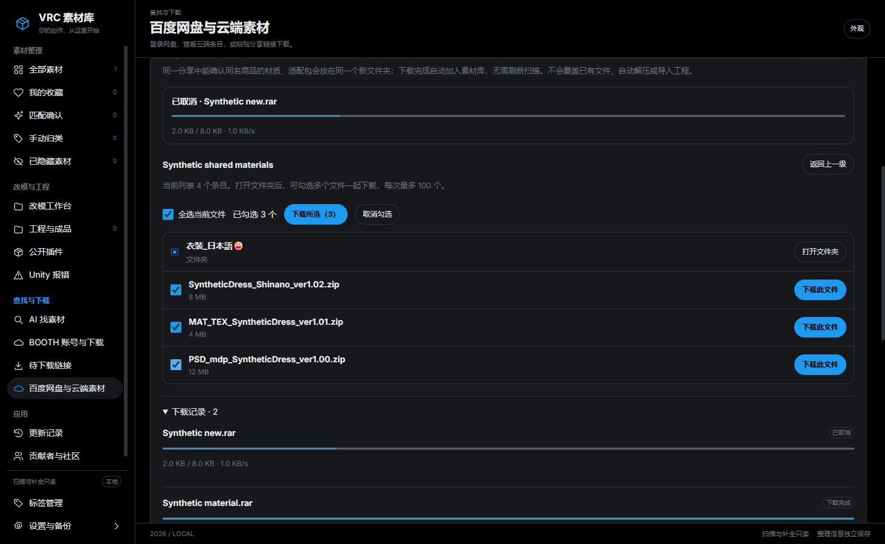

# 下载、勾选与自动入库：一步一步操作

适用版本：1.4.0-preview.14。下面的截图和文件名来自隔离测试资料库，没有用户购买记录或真实付费素材。

## 先打开新版本

退出旧的素材管理器，再运行本版。打开“更新记录”确认当前版本；仅下载了新文件但仍在使用旧窗口，旧窗口的行为不会改变。继续使用原资料库，不要删除库或重新确认全部素材。

## 百度链接：登录、读列表、勾选、下载

1. 点击左侧“百度网盘与云端素材”，或者“待下载链接”下方的百度下载区域。
2. 没登录时点击“登录百度账号”。只在百度官方登录窗口输入密码和验证码；登录后回到应用页面。
3. 把分享链接或整段分享文字粘贴到“分享链接或整段分享文字”。链接已有提取码时，下面的提取码框可以留空。
4. 点击“读取分享文件”，等待出现文件列表。文件夹显示“打开文件夹”；先打开它，才能选择里面的文件。
5. 点击文件名前的小方框勾选。勾选不是已经下载；“已勾选 N 个”表示你选了几个。也可以点“全选当前文件”，最多选 100 个。
6. 点击“下载所选（N）”。程序逐个请求正常网页下载，完成一个就加入素材库，再处理下一个。可以离开这个页面查看图库，不需要点“刷新素材”。
7. 只下载一个文件时，仍可直接点它右侧的“下载此文件”。

## 材质包与适配包为什么会在一起

例如 SyntheticDress_Shinano_ver1.02.zip、MAT_TEX_SyntheticDress_ver1.01.zip 和 PSD_mdp_SyntheticDress_ver1.00.zip，程序能识别共同的 SyntheticDress 文件族。来自同一个分享时，保存到同一个新目录。

目录名带有商品线索和一段唯一标识，例如 SyntheticDress--vrcal-编号。这段标识帮助程序区分自己创建的目录和你原有的目录，不需要手动编辑。

BOOTH 下载有明确商品编号时按商品归组；百度按分享与文件名线索归组。不同分享、不同商品、来源冲突或无法可靠判断的名称保持分开。只处理新下载，不整理或移动你已有的素材目录。

如果再次下载同名文件，会另建目录，保持原文件名并避免覆盖。不会自动解压。合并卡片只影响应用的展示，文件列表和成员路径仍保留。

## 下载完成后看哪里

- “已加入素材库，无需扫描”：文件已登记，点击左侧“全部素材”即可查看。
- “下载完成”但提示自动入库失败：文件已保存，点击“重试入库”。不需要重新下载。
- 没有封面或需要匹配确认：下载入库与确认商品是两件事。百度分享本身不能证明 BOOTH 商品身份，来源不明时继续走原有匹配流程。
- “查看下载文件”：在资源管理器中定位实际文件。

在素材库中，下载记录显示在“BOOTH 下载”或“百度网盘下载”分组。已有搜索、分类或收藏筛选可能隐藏新下载；先清空搜索、选择“全部分类”“全部分组”。

## 暂停、取消与失败

- 暂停：当前下载先停住，后面的文件继续等待。
- 继续下载：在百度允许恢复时继续当前文件。
- 取消下载：取消当前任务和剩余队列；已完成的文件保留。
- 取消后续队列：当前文件继续，尚未开始的文件取消。
- 断网、登录变化、页面列表变化或中断：停止后续队列，避免误下其他文件。完成登录或验证后重新读取、勾选需要的文件。

百度如果要求客户端或安全验证，应用会如实提示；不绕过限制，不自动启动外部下载工具。

## 闲鱼明明有链接，列表却是空的

1. 先确认运行的是本版，打开闲鱼消息窗口，进入含链接的会话。
2. 在“待下载链接”开启识别，点击“检查新链接”。这是检查当前打开会话；后台选项不会代替这次前台检查。
3. 看“闲鱼交付消息”的状态。已识别但无法核对消息日期、或者提取码冲突时，会提示查看“时间／提取码待核对”，并显示数量。
4. 点击“查看待核对链接”或对应标签页，核对链接与提取码，再点“选择文件下载”。之后仍在应用中勾选具体百度文件。

没有可靠日期的消息不会亮“近期新链接”蓝点；几天前的链接也不会当作新消息。当前真实账号全链路仍待验证。可以把分享文字直接粘贴到百度下载页面继续下载，不需要为此全局扫描素材。
