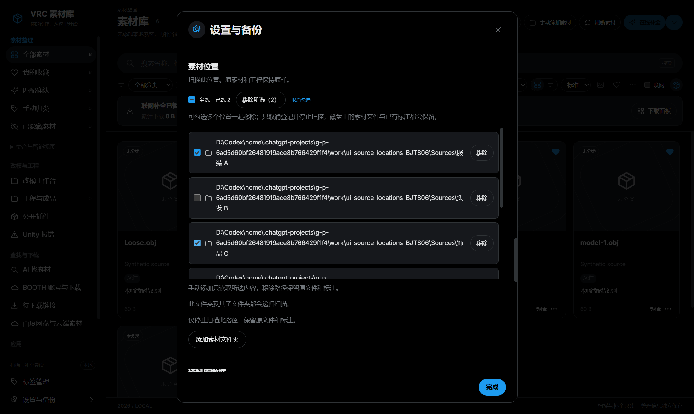

# 素材位置管理：多选、全选与批量移除

适用版本：1.4.0-preview.17 起。更新日期：2026-10-28。新增文案暂为中文。

**这里的“移除”只取消素材位置在应用中的登记，保留磁盘文件和已有标注。** 它不会删除、改名、搬动文件，也不会把文件送入系统回收站。想暂时停止整理一批文件夹，或先清空旧位置再添加自己的目录时，可使用本页步骤。

## 先找到素材位置列表

1. 打开 VRC 素材库，在主界面点击 **设置与备份**。
2. 在设置内容中向下滚动，找到标题 **素材位置**。
3. 看清每一行显示的完整路径。文件夹图标旁是登记位置；标有 **手动添加** 的位置来自手动添加，也可以在这里管理。
4. 如果扫描、下载／解压、工程导入或回收等任务仍在进行，先等待任务结束。忙碌状态可能使移除按钮不可用，或在提交时提示等待。

“素材位置”是应用读取原素材的来源。“资料库数据”中的保存位置用于索引、标注、封面和设置，二者不是同一个目录。不要为了移除扫描来源而去删除资料库文件夹。

## 勾选几个位置后一起移除

1. 点击目标路径前方的复选框，出现勾号即表示选中。继续勾选其他要移除的位置。
2. 核对已选数量和路径。只想取消某一项时，再点一次该行的复选框，勾号消失即可；取消勾选本身不会移除位置。
3. 点击 **移除所选（N）**，其中 N 是本次已选位置数，例如 **移除所选（3）**。程序一次处理本次选择，不需要再逐行点击右侧按钮，也不会额外弹出确认窗口。
4. 操作成功后，所选位置退出登记列表。未选中的位置继续保留。

没有勾选任何位置时，不能执行 **移除所选（0）**。校验或登记保存失败时，整批保持原状；核对提示后再重试。如果提示“素材位置已移除，但联网补全队列未能保存”，表示位置移除已成功，补全已暂停；检查资料库磁盘后再恢复补全，不必重复移除。

## 全选、取消勾选与全部清空

1. 勾选列表上方的 **全选**，一次选中当前登记的全部位置。
2. 如果只想保留少数位置，逐项取消这些位置前的勾号，再核对剩余选择。
3. 如果这次不想移除，点击 **取消勾选** 清掉全部勾号；也可逐项取消勾选。选中或取消选择都不会改动磁盘文件。
4. 确实要停止读取全部位置时，保持全部选中并点击 **移除所选（N）**。

全部移除后，**素材位置列表保持为空**，不会自动补回 `E:\VRChat` 等默认位置。应用没有当前登记的素材来源时，来自这些位置的素材不再展示。这不表示磁盘文件丢失，也不表示旧标注被清空。接下来可点击 **添加素材文件夹**，选择自己的素材目录。

## 只移除一个位置

每条路径右侧原有的 **移除** 按钮仍可使用。只想移除一个位置时，先核对该行路径，再点击这一行的 **移除** 即可；它与批量移除一样，只取消应用登记。

不需要先进入多选模式，也不必为单个位置全选整个列表。

## 重新添加原位置，继续使用旧标注

1. 在 **设置与备份 → 素材位置** 点击 **添加素材文件夹**。
2. 选择先前移除的原文件夹，等待读取完成。若原来源是通过手动选择文件或拖入文件加入，请用原来的手动添加方式重新加入这些文件。
3. 回到素材库，核对素材及原有的封面、标题、备注、标签、收藏、来源等资料。原文件仍在原路径且原资料库继续使用时，可以沿用已有标注。

移除登记没有把任何文件放入回收站，因此恢复来源不需要打开 Windows 回收站，也不需要重新下载。保留原路径和原资料库有助于恢复对应关系；如果文件已经被其他程序移走或改名，应先核对实际位置，不能把新路径当作原位置已自动恢复。

## 移除、隐藏和删除有什么区别

| 操作 | 作用范围 | 磁盘文件 | 如何恢复使用 |
| --- | --- | --- | --- |
| 素材位置中的移除／移除所选 | 一条或多条已登记来源，停止从这些位置读取和展示 | 保留原处，不删除、不改名、不搬动、不回收 | 重新添加原位置，读取后沿用旧标注 |
| 从资料库隐藏 | 应用中选中的素材条目，不取消整个来源 | 保留原处 | 在左侧“已隐藏素材”中恢复显示 |
| 删除（移入回收站） | 确认窗口列出的实际原文件或文件夹 | 确认后实际移入 Windows 系统回收站 | 在系统回收站还原到原路径，再刷新素材 |

位置移除不会增加“已隐藏素材”的数量，也不会释放原素材占用的磁盘空间。若目标只是让某几个素材暂时不显示，应使用隐藏；若需要实际回收原文件，须另行使用有确认步骤的删除功能。

## 常见提示与处理

- **按钮不可用或提示任务占用**：等待扫描、下载／解压、工程导入或回收结束后再试；不要通过移动原文件来绕过忙碌提示。
- **提示位置已经变化或列表需要重新读取**：核对当前设置列表，再重新勾选本次要处理的位置。整批操作失败时不会留下只移除一半的状态。
- **移除后素材卡片不见了**：这是该来源退出当前展示的结果。先到资源管理器核对原文件，再按上面的步骤重新添加原位置。
- **想换成自己的母目录**：可先全部移除登记，再添加自己的目录。素材位置应与资料库数据、备份目录分开存放，不能互相包含；无需搬动原素材来执行位置移除。

[本版说明](RELEASE_1.4.0-preview.17.zh-CN.md) · [扫描与封面规则](SCANNING_AND_COVERS.zh-CN.md) · [功能与开发参考](USER_GUIDE.md)

## 实际界面示例

下图来自隔离测试资料库，路径与素材均为合成样例。左侧复选框可以多选，顶部显示已选数量和“移除所选”按钮。

