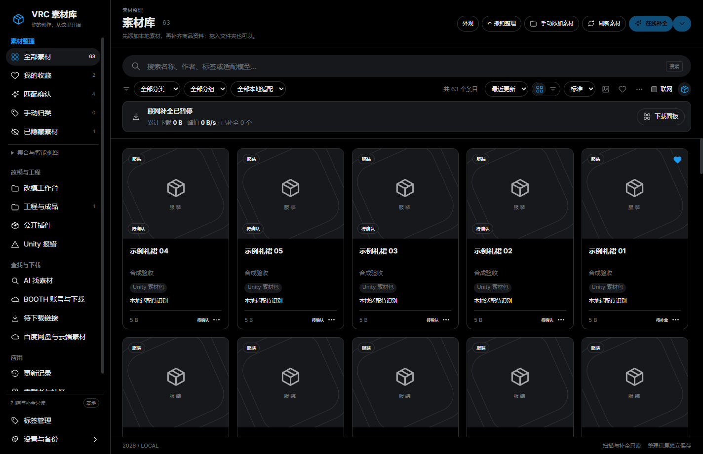
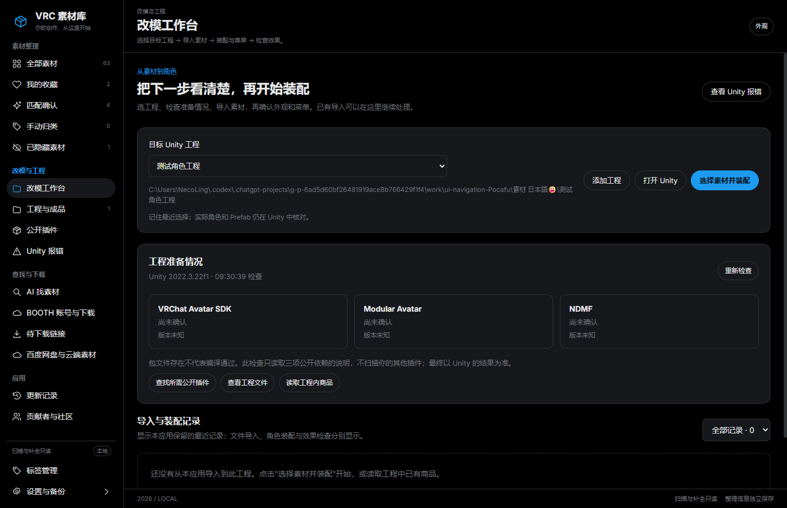
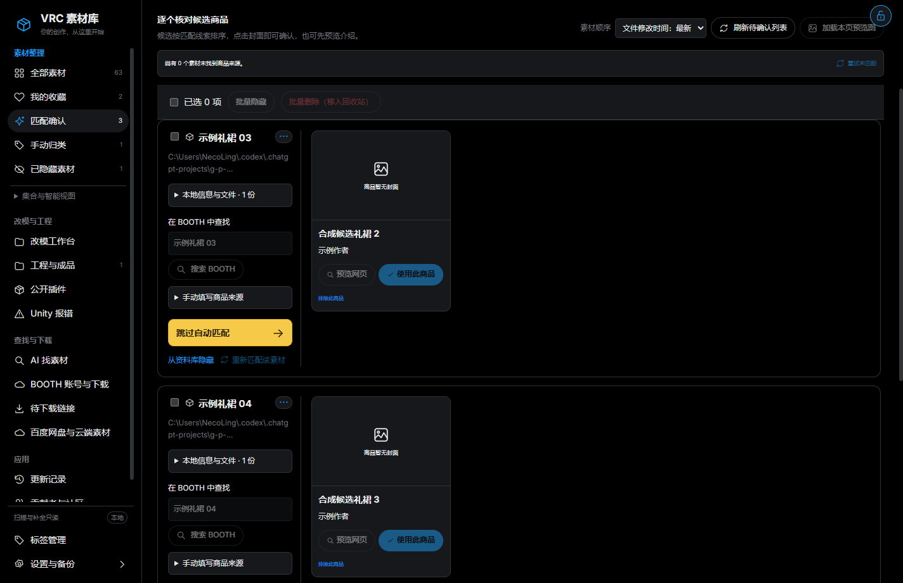
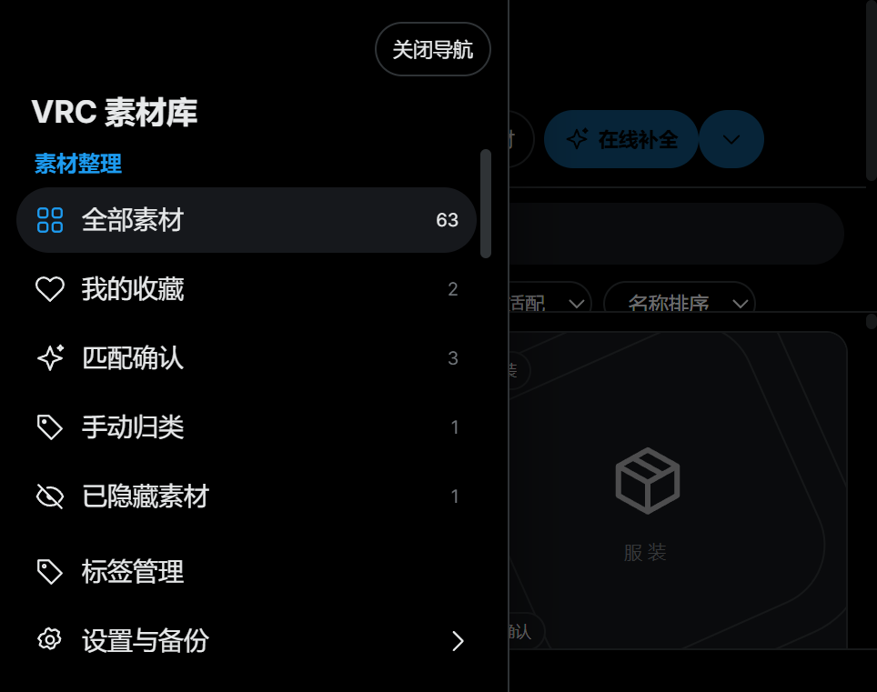

# 页面整理说明：下一步该去哪里

公开预览 1.4.0-preview.5 · 2026-10-24

这次保留原有功能，把入口按使用目的放到一起。启动仍然进入素材库，不增加必看的引导页。以下截图是隔离资料库的真实软件界面，里面的素材和工程是验收样例。

## 一、先看你要做什么

| 你现在想做什么 | 点击哪里 | 下一步 |
| --- | --- | --- |
| 看电脑上已下载的衣服、头发、工具 | 素材整理 → 全部素材 | 手动添加，或把素材文件夹拖进窗口 |
| 给已有文件找正确的商品封面和来源 | 素材整理 → 匹配确认 | 看候选图，搜索 BOOTH，找到后应用 |
| 暂时不确定素材是什么 | 匹配确认中的跳过 | 以后去手动归类继续处理 |
| 找回隐藏的条目 | 素材整理 → 已隐藏素材 | 恢复显示；原文件不会移动 |
| 把素材装进某个 Unity 工程 | 改模与工程 → 改模工作台 | 选工程，再选素材并装配 |
| 查看工程里已经有什么 | 改模与工程 → 工程与成品 | 查看对应工程；也可从工作台读取工程内商品 |
| 工程出错了 | 改模与工程 → Unity 报错 | 核对工程，读取错误，查看建议 |
| 想买/找某种风格的素材，还没有下载 | 查找与下载 → AI 找素材 | 描述需求，核对商品结果 |
| 查看 BOOTH 账号和已购下载 | 查找与下载 → BOOTH 账号与下载 | 登录后查看 |
| 查看近期发现的新下载链接 | 查找与下载 → 待下载链接 | 打开条目并接着下载 |
| 用百度网盘分享链接下载 | 查找与下载 → 百度网盘与云端素材 | 先登录，再使用下载页面 |

**匹配确认**是给你已有的文件找来源；**AI 找素材**是根据需求找商品。这两个入口不再混在一起。

## 二、整理本地素材

1. 左侧点击全部素材。
2. 已经下载了文件，点右上方手动添加素材，或直接拖入素材文件夹。刷新素材用于重新检查已登记的扫描路径。
3. 搜索框下面的全部分类可以选择服装、头发等；旁边的全部分组与全部本地适配继续可用。
4. 素材已有正确资料时直接浏览；需要核对时进入匹配确认。选错来源仍可撤回。
5. 收藏、手动归类和隐藏名单都是独立入口。隐藏是本应用不显示；移入回收站是另一项操作，两者不同。
6. 收藏夹以外的自定义清单在集合与智能视图中，点击小箭头展开。可继续新建、重命名和移除集合。

从素材库进入工作台或下载页，再回全部素材，当前搜索、分类、选中项和浏览位置会恢复。不同列表有各自的浏览条件；若看不到预期素材，先看搜索框与分类是否还有限制。

## 三、从工程列表走到装配

工程与成品用于浏览和管理工程；改模工作台用于执行安装、装配与检查。工程页顶部现在突出添加工程和进入改模工作台，不再显示素材在线补全按钮。

1. 左侧直接点击改模工作台，或从工程与成品顶部进入。
2. 选择目标工程。已有多个工程时，需要核对选中了哪一个。
3. 点击选择素材并装配，选择具体的本地文件或包，检查导入提示。
4. Unity 素材包仍在 Unity 的导入窗口核对；多个角色或预制件时按提示选择。
5. 回工作台看导入、装配、菜单和效果检查。最终外观、动作与菜单需要你确认，程序不会替你声称已经验证。
6. 点击查看 Unity 报错会带上当前工程。报错页的返回改模工作台可直接回来。

完整装配过程仍见随源码保留的改模工作台说明；这次没有改变导入或装配的执行规则。

## 四、查找和下载

把账号、商品搜索和待下载链接放在同一分组，避免到处寻找入口。下载、来源核对和入库仍是不同状态：看到链接不等于已下载，已下载不等于已装到角色上。

待下载链接有新内容时继续显示提示。BOOTH、百度网盘的登录与下载方式保持原有逻辑；页面分组不会自动扫描、自动上传或开始工程导入。

## 五、匹配确认继续保持原来的顺序

确认、跳过后继续处理下一条，不因为本次界面整理重新排序。右上方锁定按钮继续控制顶部跟着滚动还是固定。隐藏名单继续可独立打开。

## 六、主题、语言和下载状态在哪里

右上方的外观按钮收纳主题和语言选择。点开修改，点击空白处或按 Esc 收起。NASA、瑞士、X 暗色和 X 浅色四套主题仍保留。新增说明文字暂用中文，后续统一翻译。

空闲补全状态缩成摘要；累计量与最近下载仍可保留。点击下载面板，可以看到完整的速度、任务、历史与代理信息。正在处理或有待办任务的暂停状态仍展示完整提示。

更新记录和贡献者与社区在左侧应用区；设置与备份仍固定在左下角，标签管理也仍在这里。

## 七、小窗口和放大后怎么操作

Ctrl 加鼠标滚轮继续调整界面大小。显示空间较小时，点击左上方导航展开所有入口；点击目标页面、空白遮罩或按 Esc 收起。键盘可以用 Tab 在导航内移动。

在 200% 等空间很紧的情况下，上方工具区可以单独滚动，给下方素材留出浏览空间。匹配确认页仍遵循你选择的顶部锁定方式。

## 八、本次改了什么、没改什么

改动包括任务分组、上下文操作、分类位置、外观入口、紧凑状态和小窗口导航。没有改动匹配算法、素材内容、现有标注、下载器或 Unity 装配助手。

测试使用隔离资料库和合成工程。原素材清单与哈希未变。本版为公开预览，需从 GitHub 对应发布页手动下载，不进入稳定更新通道。
